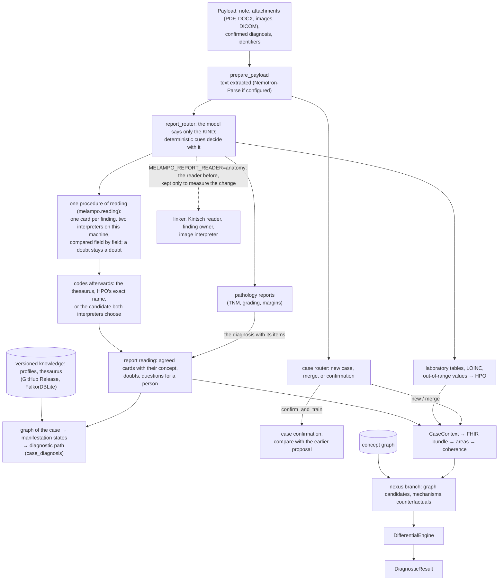

# Architecture and data model

*English · [Italiano](../it/ARCHITECTURE.md) · verified on the code of `main`, 25 November 2026*

Melampo turns the documents of a clinical case into a case graph and a ranked differential. Every text -- a
document of the patient or a medical publication -- is read by one procedure (`melampo.reading`, 25 November
2026): two interpreters each fill one card per finding (what is observed, where, by which method, with which
interpretation), the cards are compared on the sentence and field by field, a field read differently stays a
doubt, and codes are given only afterwards, to what both agree on. Patients' texts are read only by models on
this machine. Until 25 November 2026 the reports were read by a deterministic reader (anatomy, grammar,
ontologies) and the models together; that reader is kept to measure the change.

## 1. Context

```mermaid
flowchart LR
  physician["Physician<br/>(case input, review)"] --> melampo
  hospital[("Hospital documents<br/>pseudonymised at source")] --> melampo
  subgraph melampo["Melampo (one installation, in the hospital)"]
    core["Ingestion, readers,<br/>graph, differential"]
    local["Local language models<br/>(Nemotron 3 Ultra, Muse Spark Open;<br/>Gemma 4 as an option)"]
    graph[("FalkorDB<br/>concept graph")]
    stores[("Encrypted stores<br/>cases, confirmations")]
  end
  ontologies[("HPO, UBERON, PATO, MONDO,<br/>LOINC, CIPI / ICD-9-CM<br/>(pinned with DVC)")] --> melampo
  melampo -->|"research probes on PUBLIC corpora only"| openrouter["OpenRouter<br/>(PARROT, IU X-ray, MedMentions)"]
  melampo --> result["Structured differential<br/>+ questions for a person"]
```

## 2. From documents to a differential



Solid lines run on `main` today; the dotted line is the reader before the one procedure, run only when asked.
The one procedure is not yet measured on the benches of the reports (VALIDATION §5). Two parts are built but never run: the `dual_path`
retrieval (the router computes it, nothing executes it) and training (DPO, LoRA: no GPU, no confirmed labels).

## 3. Components and their state

| Component | Module | State |
|---|---|---|
| Document extraction | `data/document_processing.py` | working; without a parser it says `no_text_extracted` |
| One procedure of reading | `reading/card.py`, `reading/prompt.py`, `reading/agreement.py`, `reading/reader.py` | working, **not yet measured**: the default for the reports (`MELAMPO_REPORT_READER=one`) and the reader of the systematic review; see "One procedure of reading" below |
| Codes after agreement | `reading/normalize.py` | working: the thesaurus, HPO's own name or exact synonym, or the candidate every interpreter chooses in the sentence; the site from the lexicon when its name is exactly one class |
| Thesaurus | `reading/thesaurus.py` | working: written only from publications, versioned in the knowledge Release and graph |
| Systematic review per disease | `scripts/disease_review.py`, workflows `disease-review`, `disease-review-update` | working, first runs: PRISMA layers, saturation as a parameter, judges that verify only, weights from measured accuracy, pooled frequency, direction |
| Versioned knowledge | `scripts/knowledge_release.py`, `memory/disease_knowledge_graph.py` | working: a GitHub pre-release only when the content changes; FalkorDBLite file and FalkorDB graph |
| Report router | `data/report_router.py` | working: the deterministic cues and the reader's local model together (on when the local server is configured; the router probe: 1.1% and 0.4% of the texts with an interpreter missed, against 20.4% with the cues alone); an external model is refused for patients' texts |
| Anatomical linker | `memory/anatomy_linker.py`, `memory/chunk_lattice.py` | working; abstains when unsure. In the one procedure it gives the site of a card afterwards; the full linking is the reader before (`anatomy`) |
| Kintsch reader | `memory/ci_reader.py`, `memory/spatial_relation.py` | working; second stage reads the landmark role |
| Finding owner | `memory/finding_owner.py` | the reader before the one procedure (`MELAMPO_REPORT_READER=anatomy`), kept to measure the change; until 25 November 2026: claim by claim, on by default since 14 November 2026 (`MELAMPO_OWNER_QUESTION=owner` for question v1). Readers chosen by measure: Nemotron 3 Ultra and Muse Spark Open, both with reasoning, the uncertainty read from Muse (ctrate9: 0 errors, 3 doubts in 293 items); Gemma 4 31B is an option (see "Local readers" below) |
| What the reader knows | `memory/what_is_said.py` | abnormalities from HPO and PATO, phrase heads, negation, coordination |
| Reference library | `memory/reference_values.py`, `data/reference/` | working: reference values with their sources; only rows whose words were found on their page (`verified`) are given to the models, a row whose words do not say what it says is `doubt`; the reader recomputes the comparison of the cited row, and the measure enters the graph of the case as a value with its row (`add_measures`), so that "spleen 15 cm" makes Splenomegaly present (20 November 2026); the one procedure does not compare a card's measure with the rows yet |
| Pathology diagnosis to its finding | `data/pathology_findings.py` | in the reader before only (not yet in the one procedure): the diagnosis with its TNM, grade, margins, nodes and markers on its finding; the clinical information is the question |
| Index of the sources | `memory/sources_index.py`, `data/reference/sources.yml`, `scripts/sources_mask.py` | working: the literature, textbooks and documentation Melampo reads, how each is reached and under which licence; a mask on this computer to add, edit and remove sources, switch them on for the disease profiles and add PDFs; a weekly search adds candidate documents; the reference rows are verified by their words found on their pages |
| Sections of the report | `memory/report_sections.py` | built: indication, history, comparison, technique, findings, impression (the LOINC report sections); the conclusion and the sentence before given as context |
| Question for a person | `memory/review_question.py` | working; shown in the case reading as `questions` |
| Image interpreter | `imaging/interpreter.py`, `imaging/segmenters.py` | in the reader before only (not yet in the one procedure); working when a volume and the segmenters are configured |
| Finding → HPO term | `memory/hpo_candidates.py`, `scripts/hpo_probe.py` | probes only (90% safe, threshold 95%); replaced by the codes after agreement |
| Concept graph | `memory/falkordb_graph.py`, `memory/concept_paths.py` | working, 636,733 verified edges |
| Memory retriever | `memory/retriever.py` | **defect**: invents evidence when the memory is empty |
| Functional areas | `areas/*` | count dictionary keys, not content: to redo |
| Nexus branch, intuition, differential | `training/nexus_*`, `reasoning/*` | working |
| Graph of the case | `clinical/case_graph.py`, `clinical/case_graph_builder.py`, `clinical/manifestation_state.py` | working: built in the ingestion of every case; four states of a manifestation |
| Drug branch | `clinical/drug_branch.py`, `scripts/drug_sources.py` | working when the local cache is configured (`MELAMPO_DRUG_CACHE`) |
| Disease profiles | `memory/disease_profiles.py`, `memory/profile_library.py`, `scripts/disease_profiles.py`, `scripts/disease_names.py` | working: certain sources only, no person confirms; filled by the systematic review, read from the versioned knowledge (file, folder, `knowledge.db` or `falkordb[:version]`) |
| Diagnostic path on the graph | `reasoning/case_diagnosis.py`, `reasoning/likelihood_ranking.py` | working when the profiles are configured (`MELAMPO_DISEASE_PROFILES`): `case_diagnosis` beside the diagnosis; the cycle is to build |
| Case confirmation and merge | `training/case_confirmation.py`, `training/patient_matching.py` | working |
| Confirmed-case store | `training/confirmed_case_store.py` | encrypted, anonymised (HMAC-SHA256) |
| Review feedback | `evaluation/review_feedback.py` | a record becomes a label only after a second person confirms it |
| Training | `training/dpo_config.py`, LoRA profiles in `evaluation/model_profiles.py` | never run |
| Input and review mask | — | to build (local HTML/JS) |

### Local readers of the reports

The claims are read by two local models, chosen by measure on samples labelled before any reading
([VALIDATION](VALIDATION.md), ctrate8 and ctrate9):

| Readers | ctrate9, 293 items | Hardware (order of magnitude) |
|---|---|---|
| **Nemotron 3 Ultra + Muse Spark Open, both with reasoning** (default) | 0 errors, 3 doubts (1.0%); uncertainty from Muse: 0 lost, 0 given | Nemotron 3 Ultra about 8 GPUs; Muse Spark Open about 1 TB of memory |
| Gemma 4 31B + Muse Spark Open with reasoning (option) | 0 errors, 10 doubts (3.4%) | Gemma 4 31B one 80 GB GPU; Muse as above |
| Gemma 4 31B + Nemotron 3 Ultra with reasoning | 3 errors, 11 doubts (3.8%): not chosen | |

A doubt stays in the diagnostic path with its doubt; only a discordance goes to a person. Configuration:
`MELAMPO_LOCAL_CHAT_ENDPOINT` (this machine only), `MELAMPO_LOCAL_CHAT_MODELS` with the server's names and
`+reasoning` (for example `nemotron-3-ultra+reasoning,muse-spark-open+reasoning`), `MELAMPO_UNCERTAINTY_FROM`
(default Muse). A reader with reasoning gets 8000 tokens and is asked to reason through the chat template
(`MELAMPO_LOCAL_CHAT_EXTRA` for a server that asks it otherwise).

**The root model** of the recursive engine is Nemotron 3 Ultra with Gemma 4 31B, without reasoning
(`root_model_cross_check.DEFAULT_PAIR`, 14 November 2026): on 25 graded cases, the engine showing the model the
text it reads, both answered every case right; Muse Spark Open did not pass, in text or as native tools. The root
uses weights already chosen for the readers.

**Muse Spark Open terms** (as read by the project owner on 14 November 2026; to confirm in the legal review):
the notice "Built with Muse Spark Open" is mandatory wherever Melampo is distributed or shown with it; a model
derived from it (a fine-tuning, LoRA adapters included) is a derivative under the same terms and notice; the
clause on minors concerns the user of the model: a person using Melampo must not be a minor.

### One procedure of reading (25 November 2026)

Every text Melampo reads -- a document of the patient or a medical publication -- is read by one procedure,
`melampo.reading.read_text`, with the same functions and the same interpreters (Nemotron 3 Ultra and Muse Spark
Open, with reasoning). A report and a publication speak the same language: what is observed, where, by which
method, with which interpretation; the name is a label.

1. **One card.** Each finding is described by the same fields (`reading.card`): words, name, category, what is
   observed, its interpretation (present, increased, decreased, normal, abnormal, positive, negative), value,
   threshold, site, side, method (`observed_by`), time, nature, and the sentence. Only what the text states about
   it changes with the context: for a patient, the state (present, absent, uncertain), when (current, past,
   hypothetical) and whose (the patient, a family member); for a publication, the measures in a population, the
   direction without a number and what the measures compare. The directive is one (`reading.prompt`), the form is
   one, and what comes in another form is not read and is counted for its model.
2. **Comparison before any code.** The two interpreters' cards are compared as two reviewers compare the data
   they extracted on one form (Cochrane MECIR C45-C46): only cards of the same sentence; the same name and thing
   pair directly; otherwise every interpreter is asked, on its own and in the sentence, whether the two readings
   describe the same finding in other words, and they are paired only when every one says so; then field by
   field, what both give alike is agreed and what they give differently is a doubt (`reading.agreement`). Coding
   first would make disagreements the text does not have: two independent coders gave the same SNOMED CT code to
   three diagnoses in four (Del-Pinto et al., 2023), and codes that differ often mean the same thing.
3. **Codes afterwards.** Only the agreed reading is coded (`reading.normalize`): its label in the thesaurus; HPO's
   own name or exact synonym; otherwise the candidates sharing content words are shown to every interpreter with
   the sentence, and the reading is the candidate every one chooses; otherwise, from a publication, a new concept
   of the thesaurus, from a patient's document no concept (the finding keeps its words). The site of a patient's
   finding is the lexicon's class when its name is exactly one.
4. **The thesaurus is knowledge, not training** (`reading.thesaurus`): the concepts the interpreters agreed on,
   each label with its description, its sentence, its source and the answers; any model reads it the same way,
   as candidates. It is versioned with the knowledge (`thesaurus.jsonl` in each Release, part of the version's
   hash; `KConcept` and `KLabel` in the knowledge graph). Only publications write it; a patient's reading uses it
   and never adds to it.

A patient's text goes only to the interpreters on this machine (`report_router.local_chat`, marked
`local_only`; `read_text` refuses any other); a publication may go to OpenRouter. The same concept meets in the
graph of the case and in the profile: a finding and a manifestation with the same concept of the thesaurus match
as two with the same HPO code. A card the interpreters did not agree on enters the graph of the case as a
finding stated with uncertainty (doubtful, never decided). When an interpreter gives no reading (an answer cut
off is not a reading: it is not kept, and the summary says so), nothing of that text is agreed or coded, and
only labels that name at least two interpreters enter a thesaurus (25 November 2026, after the fifth run).

The reports were moved to the one procedure at once, by the owner's decision of 25 November 2026
(`MELAMPO_REPORT_READER`, default `one`); the reader before it (`anatomy`: the lexicon, the Kintsch reader, the
claims, the imaging interpreter) is kept only to measure the change on the same benches. Until that measure, the
error rates in the table above are the reader's before, not the one procedure's. Not yet in the one procedure:
the image side of a finding (VoxTell and TotalSegmentator, paired with the reading before) and the pathologist's
summary (TNM, grade, margins), which the reader before gave to its findings.

## 4. Data model and interoperability

| Data | Standard | Where |
|---|---|---|
| Case | HL7 FHIR resources in a bundle (`ClinicalNormalizer`) | `data/normalization.py`, `clinical/schemas.py` |
| Images | DICOM; volume + affine in patient millimetres | `data/dicom_volume.py` |
| Anatomy | TotalSegmentator classes anchored to UBERON (`part_of`, `is_a`) | `data/linking/anatomy_lexicon.json` |
| Phenotypes | HPO with PATO qualities in their logical definitions | `data/hp.obo.dvc` |
| Diseases | MONDO, DOID, HPO annotations | `data/*.dvc` |
| Laboratory | LOINC | `data/` |
| Italian procedures and diagnoses | CIPI, ICD-9-CM (weekly update) | `data/classifications_it/` |
| Finding | report, clause, mention, structure, statement, qualifiers (certainty, polarity, time), sizes, image side | `imaging/findings.py` |
| Result | `DiagnosticResult`: differential, support and contradictions, abstention, audit trace | `reasoning/diagnostic_result.py` |
| Graph of the case | branches (drugs, exams, present / hypothesized / candidate diseases); facts, knowledge and inference kept apart; four states of a manifestation (present, absent, not assessed, doubtful); exchanged as GA4GH Phenopacket v2; stored in FalkorDB | `clinical/case_graph.py`, `clinical/phenopacket.py`, `memory/case_graph_store.py` |

### The graph of the case (14 November 2026)

Ingestion builds the graph of every case from what is already read (`clinical/case_graph_builder.from_ingestion`):
the findings of the reports with their words and offsets, the laboratory rows with their printed line and LOINC
code, the declared drugs and diseases. The candidate branch is empty when the case enters: only the diagnostic
path adds to it (`CaseGraph.add_candidate`), each candidate with what proposed it. `clinical/manifestation_state`
gives each manifestation of a disease its state in the patient: absent when stated, measured within range, or
silent in an exam that studies its region; not assessed otherwise. `reasoning/likelihood_ranking` weighs present
and absent manifestations as likelihood ratios (LIRICAL's method), absences included. The result carries only the
counts (`case_graph`); the graph stays with the case.

### The drug branch and the disease profiles (15 November 2026)

`clinical/drug_branch` resolves each drug of the case through a local cache built from open sources only
(`scripts/drug_sources.py`, workflow `drug-sources`): AIFA's lists (Italian name or AIC -> ingredient, ATC; CC BY
4.0), ATC -> international name (Wikidata CC0, EMA medicines table), the US label (openFDA, CC0). It finds the
sentences of a label that name another drug of the patient (`DrugInteraction`) or a finding of the patient among
the drug's effects, with the timing against the drug's start (`DrugEffect`). The patient's list of drugs never
leaves the machine. DDInter (CC BY-NC-SA) and StatPearls (CC BY-NC-ND) are non-commercial and are not used in
production. `memory/disease_profiles` builds the profile of a disease from curated sources (HPO annotations, which carry
Orphanet's, and the Disease Ontology) and from publications open for a commercial product (CC0, CC BY, CC BY-SA:
NC and ND left out): the reading pair lists the manifestations with their sentence, an invented sentence is
refused, and the judges decide what the words do not. Wikipedia is only an index: its candidates enter with a
sentence of a publication it cites, never with its own text. Each manifestation carries its level of evidence
(established by two independent sources, reported by one), and the reading is measured against curated profiles
of rare diseases instead of by a person (workflow `disease-profiles`, with a budget).

**The sources of the profiles (18 November 2026).** The pilot read at most two reviews per disease, and 211 of its
212 manifestations had one source. The profiles now read every source the index marks for them
(`data/reference/sources.yml`, `profiles: true`), each through its connector (`memory/literature_connectors.py`):
open reviews and guidelines of Europe PMC (as many as `max_documents`), documents added by their link (PMID, PMCID,
DOI, address), PDFs of a folder; PubMed abstracts, StatPearls and the personal PDFs only in a research run
(`--research`). A source is switched on or off, added, removed, or given a PDF in the mask
(`scripts/sources_mask.py`); a new kind of source is one class in the connectors' module. A closed PDF stays on the
computer that has it (`data/private/`, never committed). The readers are the report readers (Nemotron 3 Ultra and
Muse Spark Open, with reasoning; uncapped since 20 November 2026) and the judges are independent of them (Claude Sonnet 5, Gemma 4). The HPO term is
chosen in the same reading (each reader proposes one, it must exist in HPO, the judges confirm it in the question
they already answer) and is added beside the source's words, which never disappear; what the readers call a risk
factor, a subtype or a mechanism is not a manifestation; the same finding in other words is one manifestation.

### The readers of the literature and the diagnostic path (20 November 2026)

**Readers.** The literature is read as the reports are: Nemotron 3 Ultra and Muse Spark Open, both with their own
reasoning, uncapped, and room enough to finish (60,000 tokens). The reader bench (`scripts/literature_reader_bench.py`,
workflow `literature-reader-bench`) read the same 14 texts with three configurations; the sentences not found in the
text were 5 for Nemotron + Gemma without reasoning, 1 for Nemotron + Muse with full reasoning, 20 with the reasoning
capped at 4,000 tokens (Nemotron rewrote sentences instead of copying them). The judges of the bench did not run
(no credit left): the owner chose the configuration of the reports. A quote that differs from the text only in an
apostrophe, a dash or a list bullet is the text's quote (declared correction after the run). The profiles script
stops at once when OpenRouter has no credit and writes its file after every diagnosis.

**Knowledge.** The profiles are knowledge, never learnt from patients: `memory/profile_library` loads them from
`MELAMPO_DISEASE_PROFILES` (a `profiles.json` of the workflow, or a folder of them), versioned by the hash of their
content, which the case's graph records in its snapshot. A disease is found by its MONDO concept or by its name:
the names in Italian and English come from MONDO and Wikidata (`scripts/disease_names.py`, a step of
`disease-profiles`; `MELAMPO_DISEASE_NAMES`), so "sospetta appendicite acuta" finds "acute appendicitis"; a name
shared by two diseases chooses neither.

**The diagnostic path on the graph** (`reasoning/case_diagnosis`, run by the pipeline and returned as
`case_diagnosis`, beside the pipeline's diagnosis, not in its place): the present and hypothesized diseases take
their profile; candidates enter only from the path, from the differential the pipeline computes from the findings
and from the profiles that account for findings nothing else explains (at least two of their manifestations
present); every manifestation takes its state; hypothesized and candidate diseases are ranked together by
likelihood ratios, the background taken from the whole library. The result gives each disease's contributions, the
doubts, the exams to propose (the not-assessed manifestations of the first three diseases), the findings still
unexplained and the version of the knowledge. Not yet done: the cycle until the differential stops changing, the
next exam by expected information, the drugs as causes of a candidate, the evaluation on published cases. Known
limit: a manifestation with neither a frequency nor a typicality is recorded but does not weigh; findings without
an HPO concept are compared by their words only (the finding → HPO term step is not connected).

**Weights measured (21 November 2026).** `scripts/disease_frequencies.py` (workflow `disease-frequencies`) reads,
for every disease of a profiles run, the studies of diagnostic accuracy (sensitivity, specificity, likelihood
ratios, with their setting and the patients without the disease they were measured in) and the descriptive
studies (how many patients with the disease have each manifestation); a meta-analysis's pooled values are taken
as they are, single studies are pooled by a random-effects model on the logit scale, settings are kept apart; a
word of frequency ("often") is used only when there is no number, mapped to HPO's frequency classes and weighing
half. The ranking uses a measured likelihood ratio before any frequency, its background being the patients the
study measured.

**A systematic review of every disease (22 November 2026).** `scripts/disease_review.py` (workflow
`disease-review`) takes the place of `disease-profiles` and `disease-frequencies`: for each disease, the method of a
systematic review (PRISMA) with Melampo's readers and judges. Its names (MONDO, synonyms; Europe PMC expands MeSH);
the curated layer (HPO annotations with Orphanet, Disease Ontology); every source in layers, each read to its end
page after page: the sources of the index switched on in the mask, then Europe PMC's guidelines, the Rational
Clinical Examination, systematic reviews of diagnosis, studies of diagnostic accuracy, descriptive series,
reviews, case reports; titles on another cause or form, prognosis, treatment, risk factors or epidemiology left
out; each abstract screened (Gemma 4) before the text is read; the two interpreters (Nemotron and Muse, full reasoning) interpret: the words of
the text, the general name, what it is (manifestation, test, score, outcome, risk factor, form of the disease),
one thing or a list, where it is found, pathological or physiological, the HPO term by name (a code only when it
is HPO's own name or exact synonym), which known manifestation it is; what they read differently stays a doubt;
the sentence and its numbers in the text; the two judges only verify that the sentence states it; each curated manifestation no text stated searched by itself; the weights by the order of
`disease_frequencies`. Exams and scores go to `tests.json` and `scores.json`.

**Corrections of 23 November 2026, after the second run.** (A) A sign, a laboratory value beyond a cut-off, an
imaging finding is a manifestation, with its accuracy; a test is an examination as a whole (CT, ultrasound, MRI),
used for the next exam. (B) A statement of direction without a number ("makes the disease more likely", "less
likely", with its words of strength) is recorded on the manifestation and weighs by a provisional likelihood ratio
(2 or 0.5, squared when stated strongly), to be calibrated on published cases at step 9; sources that disagree
weigh nothing. (C) A measure comparing two forms of the disease does not weigh the diagnosis. (D) A result stated
more than once in one article, with the same numbers, counts once when studies are pooled; every sentence stays a
citation.

**Corrections of 24 November 2026, after the third run** (appendicitis, 34 texts, 3 USD: 79 manifestations, 6
with a measured accuracy). (E) One format for every model (the owner's rule: the models are
interchangeable, with one directive): the prompt gives the exact form of an object, the measures inside one
"measures" object or null; what comes in another form is not read and is counted for the model that sent it
(`format` in the summary). Nemotron had put its measures inside "measures" for 189 of its 549 items, Muse outside:
the questionnaire, now `r4`, is read again. (F) A measure is one value the text states as one value: "up to 98 %
sensitive", "from 30 to 80 %", "79 % accurate" are not a sensitivity or a frequency (the manifestation stays,
without the measure, the reason kept as a doubt). (G) Each interpreter's reading is its own record: a measure
weighs only when both interpreters read it in the same source with the same numbers, a statement of direction only
when both read it in the same source; a link to an HPO term or to a known manifestation read by one interpreter
alone is not made (one interpreter alone had joined the peak systolic velocity to the colour Doppler flow, and
vomiting before pain to vomiting); a source whose agreed results for one manifestation differ weighs nothing for it.
(H) At the end of a disease's review, the two interpreters, each on its own, group the names of the profile that
are the same manifestation ("psoas sign" and "positive psoas sign") and join an absence to the thing ("absence of
fever" to fever, with its direction for "absent"); only what both group together is joined, a group with two HPO
codes is not. (I) A statement of direction is verified by the judges as a claim of its own ("vomiting before pain,
when present, makes appendicitis less likely"). (J) A page of Europe PMC that does not answer is tried again four
times; the hits of every layer are written, and a layer that cannot be read ends the review as
`sources_unreachable`, not as saturated (in the third run four layers, among them the accuracy studies and the
series of patients, gave no text, without a trace of why); a saturated layer is not paged to its end. Measures of
earlier knowledge versions, read before (G), carry no interpreter and weigh nothing until read again.

**After the fourth run (24 November 2026).** Every page asked of a server (Europe PMC, PubMed, the sources of the
index) is asked again when the server does not answer (a timeout, a connection broken, 429, a 5xx); a page given
up is counted in `pages_not_read` of the summary, and what the sources of the index gave, source by source, is in
`index` (in the fourth run the index gave no text, without a trace). Out of the budget, 10 % (at most 0.50 USD) is
kept for the grouping of the names at the end of each review, so that a review stopped by its budget is still
grouped; a review stopped because OpenRouter has no credit left is written without the grouping, and says so.


**25 November 2026: the one procedure of reading.** The review reads every text with `melampo.reading` (questionnaire
`r5`), the same procedure as a patient's documents (see "One procedure of reading"). It replaces the reader's own
prompt, the joining of the two interpreters by identical names and the grouping of the names at the end of each
review (H): two interpreters' readings of one finding are paired in the sentence, and the names of one finding
across texts meet in the thesaurus (an agreed label, or a candidate both interpreters choose).


**The budget is never passed (25 November 2026, the owner's rule: not over 5 USD).** Before each call to OpenRouter
the router holds the most the call can cost -- the prompt at the model's input price, a token for every three
characters, and every token it may write at the output price, from OpenRouter's own price list (1 USD for a
model with no known price) -- and refuses the call when what is spent, plus what the calls already running hold,
plus this one's most, would pass the budget. The review stops a little before the budget, never after it.

**When a review stops: the saturation is a parameter** (the owner's rule, 22 November 2026). `--saturation N`:
each layer of sources of a disease's review stops when N texts in a row, read and judged, add no manifestation, and the review goes on to the next layer (counted layer by layer since the first run: counted on the whole review, five guideline abstracts stopped it before the accuracy studies and the series of patients, where the weights are). The least is 5 (a
smaller value is raised to 5); `0` means no limit: every text of every layer is read, to the end of the sources.
No other limit is set beforehand; only the budget stops a run, and the next run resumes from it (`resume_run`).
The curve of texts read and manifestations added is written for every disease (`curves.json`).

**The knowledge, versioned, and the living review (22 November 2026).** Each version of the disease knowledge is
a GitHub Release, never a commit: a pre-release tagged `knowledge-<date>-<version>` (not taken for a release of the
software), made by `scripts/knowledge_release.sh` only from the two workflows of the knowledge, and only when the
content changed (its hash): a push or a merge of code makes none. It holds `knowledge.db` (the graph, ready, in
FalkorDBLite), the files it is built from (profiles, names, exams, scores, curves, the measures the weights are
computed from, the day of each review, the logs of readings and verdicts; the texts read are not published: an
abstract or a full text belongs to its authors), `changes.md` (what changed, disease by disease) and
`version.json`. Every Monday `disease-review-update` downloads the latest Release, reviews each disease again on
what was published from the day of its last review, by the same method, with no saturation (every new text is
read), computes the weights again on every measure, old and new, and makes a new Release if anything changed. It
takes the place of the daily literature refresh on `main`, switched off the same day (it can still be run by hand).

**The knowledge graph (22 November 2026).** The diagnosis reads the knowledge as a graph
(`memory/disease_knowledge_graph.py`): `(:KVersion)<-[:IN]-(:KDisease)-[:SHOWS {frequency, sensitivity,
specificity, LR+, LR-}]->(:KManifestation)` and `(:KDisease)-[:DETECTED_BY]->(:KTest)`, with the version id every
case records, so that the diseases showing some manifestations are one query. `MELAMPO_DISEASE_PROFILES` names
the `knowledge.db` of a Release (opened with FalkorDBLite, nothing rebuilt), or a JSON file or folder, or
`falkordb[:<version>]` for a FalkorDB server (`data/falkordb_config.toml`, `MELAMPO_FALKORDB_SERVICE`,
`MELAMPO_FALKORDB_USERNAME`, `MELAMPO_FALKORDB_PASSWORD`), which `scripts/knowledge_graph.py` loads. Only public
knowledge goes there, never a patient's case.

## 5. Data boundaries

| Data | May go to | Never goes to | Enforced by |
|---|---|---|---|
| Patients' reports and notes | local models (`report_router.local_chat`, marked `local_only`) | any external service; the thesaurus and any published knowledge | the router refuses an external endpoint, `read_text` refuses a chat that is not local for a patient's text, only publications write the thesaurus; tests `test_an_external_model_is_refused`, `test_a_patients_text_is_read_only_on_this_machine`, `test_the_same_procedure_codes_afterwards_and_a_patient_never_writes_the_thesaurus` |
| Publications read for the disease profiles | OpenRouter (the interpreters and judges); the Release: readings, verdicts and the short sentences cited with their source | the Release: the texts read (they belong to their authors and publishers) | `knowledge_publish.LOGS` without `texts.jsonl` |
| Public corpora (PARROT, IU X-ray, MedMentions, E3C) | OpenRouter, in probes, with `--public-data` | the repository (texts are not committed: labels only) | `check_endpoint`; test `test_an_external_endpoint_needs_public_texts` |
| Confirmed cases | encrypted store, anonymised with HMAC-SHA256 | training without a declared clinical basis | `ConfirmedCaseStore`, `case_confirmation` |
| Review answers | review feedback | training before a second person confirms | `review_feedback`; test `test_text_that_is_not_pseudonymised_is_refused` |
| Secrets (`DB_PASSWORD`, `OPENROUTER_API_KEY`, `HF_TOKEN`) | environment and GitHub secrets | code, logs, documents | review; never in a commit |

No component makes a network call that is not configured explicitly.

## 6. Human oversight

A person decides wherever the readers do not agree; nothing is removed or promoted silently.

- **Reading a sentence:** the reader alone, or the models alone, never set a finding aside. Two models count as
  one stream and must agree with each other first.
- **Questions for a person:** complete in themselves (sentence, structure, closed answers); the system's
  readings are shown only after the answer, so they do not steer it.
- **Hypotheses from the nexus branch:** `PromotionPolicy` gives `needs_review`, never an automatic promotion.
- **Training data:** only confirmed cases with a clinical basis, and review answers confirmed by a second person.

## 7. Decisions

Short form; the full records are in the tag `docs-archive-2026-11`.

| Date | Decision | Still valid |
|---|---|---|
| 2026-09-26 | Imaging: each abnormal region isolated and described by size, shape, density; report↔image discrepancy out of scope | yes |
| 2026-10-02 | Vector and concept store is FalkorDB, not Weaviate | yes |
| 2026-10-02 | Imaging chain: VoxTell → geometry → pairing → graph nodes | yes |
| (RLM record) | Retrieval is recursive navigation over the governed memory, with named primitives and no code execution, depth 1 | yes; `dual_path` not yet run |
| (diagnostic engine record) | The model ranks diagnoses; the graph says what each rests on; a deterministic calibrator decides whether a result may leave | yes |
| (hypothesis stream record) | Hypotheses are found in the graph, not written by a model; isolated from the evidence path | yes |
| 2026-10-12 | Deterministic only where the vocabulary has the exact match; otherwise the reader and a model read | yes |
| 2026-10-14 | Option b: several roles may be true together; reader and model must agree on what changes the outcome; a person on contradiction | yes |
| 2026-10-30 | Narrative reader and image interpreter run in ingestion | yes |
| 2026-10-31 | The landmark role; the finding owner decided by reader and models together | yes |
| 2026-11-02 | No label chosen from an ordered list: claims with copied words; the reader checks with ontologies and grammar, never with word lists made for cases | yes |
| 2026-11-04 | A measure is compared with a reference value from a cited source, never with what a model remembers; paragraphs, not chapters, of the sources; for research open literature and Radiopaedia | yes |
| 2026-11-07 | Selective recall: a word is read first in the context of the report (its structure, its section, its conclusion); a sense of another species is never recalled; where a name has a sense of the body formed and one of the embryo, the embryo's is recalled only in a report about development (9 November 2026). One finding may hold several places, and several findings one place | yes |
| 2026-11-07 | The principle of doubt: what is not certain stays in the diagnostic path as a finding in doubt, with every reading beside it, closed by the conclusion, the reader's unambiguous knowledge (HPO, PATO), other reports, the history or a new exam; certain when two sources of different mechanism hold it; a person only for a discordance of the document; every error share under 2% | yes |
| 2026-11-08 | The pathologist's diagnosis is given to its finding with its TNM, grade, margins, nodes and markers; the clinical information of a pathology report is the question, the material where the sample comes from; an item is given only where it certainly belongs (its line of the diagnosis, or the one structure the diagnosis names), otherwise it stays with the report and says why | yes |
| 2026-11-08 | A reference value holds because its source says it: a row is verified when the words it cites are found on its page, word for word; no status rests on a person's memory, a radiologist's included; the sources are indexed with how each is reached, updated every week by the project's search and by hand through a mask | yes |
| 2026-11-09 | The structures of the embryo are not excluded beforehand: a name with one sense keeps it ("trophoblast"); a name with a sense of the body formed and one of the embryo ("aortic arch") recalls the embryo's only in an obstetric, fetal or pregnancy report | yes |
