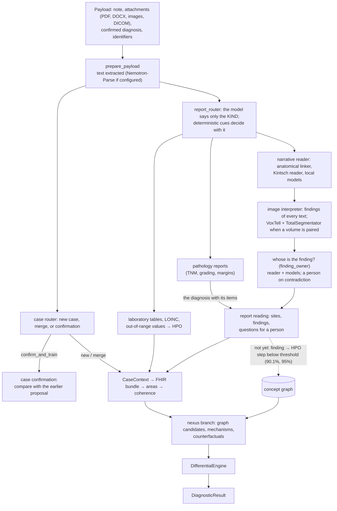

# Architecture and data model

*English · [Italiano](../it/ARCHITECTURE.md) · verified on the code of `main`, 2 November 2026*

Melampo turns the documents of a clinical case into a case graph and a ranked differential. Every step that
reads text is done by two readers that must agree, a deterministic reader that brings what a radiologist knows
(anatomy, grammar, ontologies) and language models that read the sentence; when they contradict each other a
person decides. Patients' texts are read only by local models.

## 1. Context

```mermaid
flowchart LR
  physician["Physician<br/>(case input, review)"] --> melampo
  hospital[("Hospital documents<br/>pseudonymised at source")] --> melampo
  subgraph melampo["Melampo (one installation, in the hospital)"]
    core["Ingestion, readers,<br/>graph, differential"]
    local["Local language models<br/>(Nemotron 3 Ultra, Muse Spark Open;<br/>Gemma 4 as an option)"]
    graph[("FalkorDB<br/>concept graph")]
    stores[("Encrypted stores<br/>cases, confirmations")]
  end
  ontologies[("HPO, UBERON, PATO, MONDO,<br/>LOINC, CIPI / ICD-9-CM<br/>(pinned with DVC)")] --> melampo
  melampo -->|"research probes on PUBLIC corpora only"| openrouter["OpenRouter<br/>(PARROT, IU X-ray, MedMentions)"]
  melampo --> result["Structured differential<br/>+ questions for a person"]
```

## 2. From documents to a differential



Solid lines run on `main` today; the dotted line does not. Two parts are built but never run: the `dual_path`
retrieval (the router computes it, nothing executes it) and training (DPO, LoRA: no GPU, no confirmed labels).

## 3. Components and their state

| Component | Module | State |
|---|---|---|
| Document extraction | `data/document_processing.py` | working; without a parser it says `no_text_extracted` |
| Report router | `data/report_router.py` | working: the deterministic cues and the reader's local model together (on when the local server is configured; the router probe: 1.1% and 0.4% of the texts with an interpreter missed, against 20.4% with the cues alone); an external model is refused for patients' texts |
| Anatomical linker | `memory/anatomy_linker.py`, `memory/chunk_lattice.py` | working; abstains when unsure |
| Kintsch reader | `memory/ci_reader.py`, `memory/spatial_relation.py` | working; second stage reads the landmark role |
| Finding owner | `memory/finding_owner.py` | working: claim by claim, on by default since 14 November 2026 (`MELAMPO_OWNER_QUESTION=owner` for question v1). Readers chosen by measure: Nemotron 3 Ultra and Muse Spark Open, both with reasoning, the uncertainty read from Muse (ctrate9: 0 errors, 3 doubts in 293 items); Gemma 4 31B is an option (see "Local readers" below) |
| What the reader knows | `memory/what_is_said.py` | abnormalities from HPO and PATO, phrase heads, negation, coordination |
| Reference library | `memory/reference_values.py`, `data/reference/` | built: reference values with their sources (to verify), paragraphs in a local copy; the models compare a measure only with a cited row, the reader recomputes it |
| Pathology diagnosis to its finding | `data/pathology_findings.py` | working: the diagnosis with its TNM, grade, margins, nodes and markers on its finding; the clinical information is the question |
| Index of the sources | `memory/sources_index.py`, `data/reference/sources.yml`, `scripts/sources_mask.py` | working: the literature, textbooks and documentation Melampo reads, how each is reached and under which licence; a mask on this computer to add and edit; a weekly search adds candidate documents; the reference rows are verified by their words found on their pages |
| Sections of the report | `memory/report_sections.py` | built: indication, history, comparison, technique, findings, impression (the LOINC report sections); the conclusion and the sentence before given as context |
| Question for a person | `memory/review_question.py` | working; shown in the case reading as `questions` |
| Image interpreter | `imaging/interpreter.py`, `imaging/segmenters.py` | working when a volume and the segmenters are configured |
| Finding → HPO term | `memory/hpo_candidates.py`, `scripts/hpo_probe.py` | probes only (90% safe, threshold 95%) |
| Concept graph | `memory/falkordb_graph.py`, `memory/concept_paths.py` | working, 636,733 verified edges |
| Memory retriever | `memory/retriever.py` | **defect**: invents evidence when the memory is empty |
| Functional areas | `areas/*` | count dictionary keys, not content: to redo |
| Nexus branch, intuition, differential | `training/nexus_*`, `reasoning/*` | working |
| Case confirmation and merge | `training/case_confirmation.py`, `training/patient_matching.py` | working |
| Confirmed-case store | `training/confirmed_case_store.py` | encrypted, anonymised (HMAC-SHA256) |
| Review feedback | `evaluation/review_feedback.py` | a record becomes a label only after a second person confirms it |
| Training | `training/dpo_config.py`, LoRA profiles in `evaluation/model_profiles.py` | never run |
| Input and review mask | — | to build (local HTML/JS) |

### Local readers of the reports

The claims are read by two local models, chosen by measure on samples labelled before any reading
([VALIDATION](VALIDATION.md), ctrate8 and ctrate9):

| Readers | ctrate9, 293 items | Hardware (order of magnitude) |
|---|---|---|
| **Nemotron 3 Ultra + Muse Spark Open, both with reasoning** (default) | 0 errors, 3 doubts (1.0%); uncertainty from Muse: 0 lost, 0 given | Nemotron 3 Ultra about 8 GPUs; Muse Spark Open about 1 TB of memory |
| Gemma 4 31B + Muse Spark Open with reasoning (option) | 0 errors, 10 doubts (3.4%) | Gemma 4 31B one 80 GB GPU; Muse as above |
| Gemma 4 31B + Nemotron 3 Ultra with reasoning | 3 errors, 11 doubts (3.8%): not chosen | |

A doubt stays in the diagnostic path with its doubt; only a discordance goes to a person. Configuration:
`MELAMPO_LOCAL_CHAT_ENDPOINT` (this machine only), `MELAMPO_LOCAL_CHAT_MODELS` with the server's names and
`+reasoning` (for example `nemotron-3-ultra+reasoning,muse-spark-open+reasoning`), `MELAMPO_UNCERTAINTY_FROM`
(default Muse). A reader with reasoning gets 8000 tokens and is asked to reason through the chat template
(`MELAMPO_LOCAL_CHAT_EXTRA` for a server that asks it otherwise).

**Muse Spark Open terms** (as read by the project owner on 14 November 2026; to confirm in the legal review):
the notice "Built with Muse Spark Open" is mandatory wherever Melampo is distributed or shown with it; a model
derived from it (a fine-tuning, LoRA adapters included) is a derivative under the same terms and notice; the
clause on minors concerns the user of the model: a person using Melampo must not be a minor.

## 4. Data model and interoperability

| Data | Standard | Where |
|---|---|---|
| Case | HL7 FHIR resources in a bundle (`ClinicalNormalizer`) | `data/normalization.py`, `clinical/schemas.py` |
| Images | DICOM; volume + affine in patient millimetres | `data/dicom_volume.py` |
| Anatomy | TotalSegmentator classes anchored to UBERON (`part_of`, `is_a`) | `data/linking/anatomy_lexicon.json` |
| Phenotypes | HPO with PATO qualities in their logical definitions | `data/hp.obo.dvc` |
| Diseases | MONDO, DOID, HPO annotations | `data/*.dvc` |
| Laboratory | LOINC | `data/` |
| Italian procedures and diagnoses | CIPI, ICD-9-CM (weekly update) | `data/classifications_it/` |
| Finding | report, clause, mention, structure, statement, qualifiers (certainty, polarity, time), sizes, image side | `imaging/findings.py` |
| Result | `DiagnosticResult`: differential, support and contradictions, abstention, audit trace | `reasoning/diagnostic_result.py` |

## 5. Data boundaries

| Data | May go to | Never goes to | Enforced by |
|---|---|---|---|
| Patients' reports and notes | local models (`report_router.local_chat`) | any external service | the router refuses an external endpoint; test `test_an_external_model_is_refused` |
| Public corpora (PARROT, IU X-ray, MedMentions, E3C) | OpenRouter, in probes, with `--public-data` | the repository (texts are not committed: labels only) | `check_endpoint`; test `test_an_external_endpoint_needs_public_texts` |
| Confirmed cases | encrypted store, anonymised with HMAC-SHA256 | training without a declared clinical basis | `ConfirmedCaseStore`, `case_confirmation` |
| Review answers | review feedback | training before a second person confirms | `review_feedback`; test `test_text_that_is_not_pseudonymised_is_refused` |
| Secrets (`DB_PASSWORD`, `OPENROUTER_API_KEY`, `HF_TOKEN`) | environment and GitHub secrets | code, logs, documents | review; never in a commit |

No component makes a network call that is not configured explicitly.

## 6. Human oversight

A person decides wherever the readers do not agree; nothing is removed or promoted silently.

- **Reading a sentence:** the reader alone, or the models alone, never set a finding aside. Two models count as
  one stream and must agree with each other first.
- **Questions for a person:** complete in themselves (sentence, structure, closed answers); the system's
  readings are shown only after the answer, so they do not steer it.
- **Hypotheses from the nexus branch:** `PromotionPolicy` gives `needs_review`, never an automatic promotion.
- **Training data:** only confirmed cases with a clinical basis, and review answers confirmed by a second person.

## 7. Decisions

Short form; the full records are in the tag `docs-archive-2026-11`.

| Date | Decision | Still valid |
|---|---|---|
| 2026-09-26 | Imaging: each abnormal region isolated and described by size, shape, density; report↔image discrepancy out of scope | yes |
| 2026-10-02 | Vector and concept store is FalkorDB, not Weaviate | yes |
| 2026-10-02 | Imaging chain: VoxTell → geometry → pairing → graph nodes | yes |
| (RLM record) | Retrieval is recursive navigation over the governed memory, with named primitives and no code execution, depth 1 | yes; `dual_path` not yet run |
| (diagnostic engine record) | The model ranks diagnoses; the graph says what each rests on; a deterministic calibrator decides whether a result may leave | yes |
| (hypothesis stream record) | Hypotheses are found in the graph, not written by a model; isolated from the evidence path | yes |
| 2026-10-12 | Deterministic only where the vocabulary has the exact match; otherwise the reader and a model read | yes |
| 2026-10-14 | Option b: several roles may be true together; reader and model must agree on what changes the outcome; a person on contradiction | yes |
| 2026-10-30 | Narrative reader and image interpreter run in ingestion | yes |
| 2026-10-31 | The landmark role; the finding owner decided by reader and models together | yes |
| 2026-11-02 | No label chosen from an ordered list: claims with copied words; the reader checks with ontologies and grammar, never with word lists made for cases | yes |
| 2026-11-04 | A measure is compared with a reference value from a cited source, never with what a model remembers; paragraphs, not chapters, of the sources; for research open literature and Radiopaedia | yes |
| 2026-11-07 | Selective recall: a word is read first in the context of the report (its structure, its section, its conclusion); a sense of another species is never recalled; where a name has a sense of the body formed and one of the embryo, the embryo's is recalled only in a report about development (9 November 2026). One finding may hold several places, and several findings one place | yes |
| 2026-11-07 | The principle of doubt: what is not certain stays in the diagnostic path as a finding in doubt, with every reading beside it, closed by the conclusion, the reader's unambiguous knowledge (HPO, PATO), other reports, the history or a new exam; certain when two sources of different mechanism hold it; a person only for a discordance of the document; every error share under 2% | yes |
| 2026-11-08 | The pathologist's diagnosis is given to its finding with its TNM, grade, margins, nodes and markers; the clinical information of a pathology report is the question, the material where the sample comes from; an item is given only where it certainly belongs (its line of the diagnosis, or the one structure the diagnosis names), otherwise it stays with the report and says why | yes |
| 2026-11-08 | A reference value holds because its source says it: a row is verified when the words it cites are found on its page, word for word; no status rests on a person's memory, a radiologist's included; the sources are indexed with how each is reached, updated every week by the project's search and by hand through a mask | yes |
| 2026-11-09 | The structures of the embryo are not excluded beforehand: a name with one sense keeps it ("trophoblast"); a name with a sense of the body formed and one of the embryo ("aortic arch") recalls the embryo's only in an obstetric, fetal or pregnancy report | yes |
