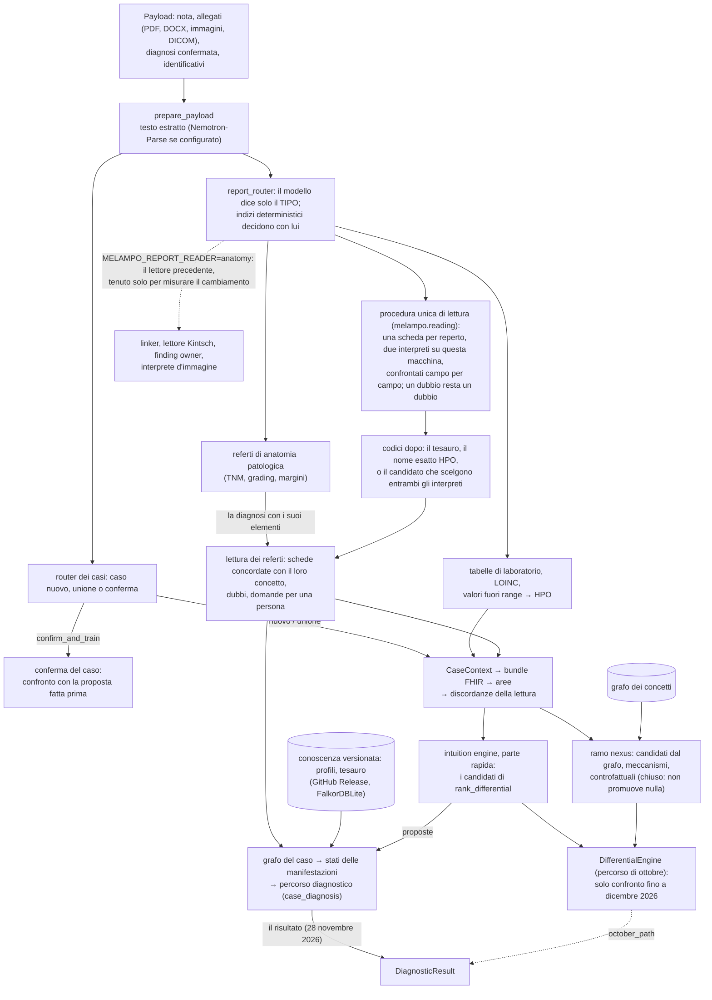

# Architettura e modello dei dati

*[English](../en/ARCHITECTURE.md) · Italiano · verificata sul codice di `main`, 25 novembre 2026*

Melampo trasforma i documenti di un caso clinico in un grafo del caso e in un differenziale ordinato. Ogni testo --
un documento del paziente o una pubblicazione medica -- si legge con una sola procedura (`melampo.reading`, 25
novembre 2026): due interpreti riempiono ciascuno una scheda per reperto (che cosa si osserva, dove, con quale
metodo, con quale interpretazione), le schede si confrontano sulla frase e campo per campo, un campo letto diverso
resta un dubbio, e i codici si danno solo dopo, a ciò su cui entrambi concordano. I testi dei pazienti li leggono
solo modelli su questa macchina. Fino al 25 novembre 2026 i referti li leggevano un lettore deterministico
(anatomia, grammatica, ontologie) e i modelli insieme; quel lettore resta per misurare il cambiamento.

## 1. Contesto

```mermaid
flowchart LR
  physician["Medico<br/>(immissione del caso, revisione)"] --> melampo
  hospital[("Documenti dell'ospedale<br/>pseudonimizzati alla fonte")] --> melampo
  subgraph melampo["Melampo (un'installazione, in ospedale)"]
    core["Acquisizione, lettori,<br/>grafo, differenziale"]
    local["Modelli linguistici locali<br/>(Nemotron 3 Ultra, Muse Spark Open;<br/>Gemma 4 come opzione)"]
    graph[("FalkorDB<br/>grafo dei concetti")]
    stores[("Archivi cifrati<br/>casi, conferme")]
  end
  ontologies[("HPO, UBERON, PATO, MONDO,<br/>LOINC, CIPI / ICD-9-CM<br/>(pin con DVC)")] --> melampo
  melampo -->|"probe di ricerca SOLO su corpora PUBBLICI"| openrouter["OpenRouter<br/>(PARROT, IU X-ray, MedMentions)"]
  melampo --> result["Differenziale strutturato<br/>+ domande per una persona"]
```

## 2. Dai documenti al differenziale



Le linee continue girano oggi su `main`; quella tratteggiata è il lettore precedente alla procedura unica, che
gira solo se richiesto. La procedura unica non è ancora misurata sui banchi dei referti (VALIDATION §5). Due parti sono costruite ma mai eseguite: il
recupero `dual_path` (il router lo calcola, nessuno lo esegue) e l'addestramento (DPO, LoRA: nessuna GPU, nessuna
etichetta confermata).

## 3. Componenti e loro stato

| Componente | Modulo | Stato |
|---|---|---|
| Estrazione dai documenti | `data/document_processing.py` | funziona; senza parser dice `no_text_extracted` |
| Procedura unica di lettura | `reading/card.py`, `reading/prompt.py`, `reading/agreement.py`, `reading/reader.py` | funziona, **non ancora misurata**: predefinita per i referti (`MELAMPO_REPORT_READER=one`) e lettore della revisione sistematica; vedi "Una sola procedura di lettura" sotto |
| Codici dopo l'accordo | `reading/normalize.py` | funziona: il tesauro, il nome proprio o il sinonimo esatto di HPO, o il candidato che ogni interprete sceglie nella frase; la sede dal lessico quando il suo nome è esattamente una classe |
| Tesauro | `reading/thesaurus.py` | funziona: scritto solo dalle pubblicazioni, versionato nella Release e nel grafo della conoscenza |
| Revisione sistematica per malattia | `scripts/disease_review.py`, workflow `disease-review`, `disease-review-update` | funziona, primi run: strati PRISMA, saturazione come parametro, giudici che verificano soltanto, pesi dall'accuratezza misurata, dalla frequenza aggregata, dalla direzione |
| Conoscenza versionata | `scripts/knowledge_release.py`, `memory/disease_knowledge_graph.py` | funziona: una pre-release di GitHub solo quando il contenuto cambia; file FalkorDBLite e grafo FalkorDB |
| Orchestratore dei referti | `data/report_router.py` | funziona: indizi deterministici e modello locale del lettore insieme (acceso quando il server locale è configurato; misura del router: 1,1% e 0,4% dei testi con un interprete mancato, contro il 20,4% dei soli indizi); un modello esterno è rifiutato per i testi dei pazienti. La procedura unica segue la sua scelta (27 novembre 2026): un documento solo per l'estrattore del laboratorio non è riletto dagli interpreti, una riga di una lettera già letta dall'estrattore entra nel caso una volta sola, e un allegato di nessun tipo riconosciuto va a una persona (inserito per errore, di un altro paziente, non medico o non pertinente) e non è letto nel caso. Prima, gli identificativi di ogni documento sono confrontati con quelli del paziente (`data/patient_check.py`, R22): il documento di un altro paziente resta fuori dal testo, dalle righe di laboratorio, dalle immagini e da entrambi i lettori, con la sua domanda per una persona |
| Linker anatomico | `memory/anatomy_linker.py`, `memory/chunk_lattice.py` | funziona; si astiene quando non è sicuro. Nella procedura unica dà dopo la sede di una scheda; il collegamento completo è del lettore precedente (`anatomy`) |
| Lettore Kintsch | `memory/ci_reader.py`, `memory/spatial_relation.py` | funziona; il secondo stadio legge il ruolo di riferimento |
| Finding owner | `memory/finding_owner.py` | il lettore precedente alla procedura unica (`MELAMPO_REPORT_READER=anatomy`), tenuto per misurare il cambiamento; fino al 25 novembre 2026: per affermazioni, accesa di default dal 14 novembre 2026 (`MELAMPO_OWNER_QUESTION=owner` per la domanda v1). Lettori scelti per misura: Nemotron 3 Ultra e Muse Spark Open, entrambi con ragionamento, l'incertezza letta da Muse (ctrate9: 0 errori, 3 dubbi su 293 item); Gemma 4 31B è un'opzione (vedi "Lettori locali" sotto) |
| Ciò che sa il lettore | `memory/what_is_said.py` | anomalie da HPO e PATO, testa del sintagma, negazione, coordinazione |
| Biblioteca di riferimento | `memory/reference_values.py`, `data/reference/` | funziona: valori di riferimento con le fonti; ai modelli vanno solo le righe le cui parole sono state trovate sulla pagina (`verified`), una riga le cui parole non dicono ciò che dice la riga è `doubt`; il lettore ricalcola il confronto della riga citata, e la misura entra nel grafo del caso come valore con la sua riga (`add_measures`), così "milza 15 cm" rende presente la splenomegalia (20 novembre 2026). Nella procedura unica (27 novembre 2026, `reading/case_sides.py`): una scheda con una struttura e un valore scritto nella frase è mostrata a ogni interprete con le righe verificate della sua struttura, esame e unità, una domanda per documento; la riga conta solo se ogni interprete la sceglie, il confronto è fatto con il numero della frase, e interpreti che scelgono diversamente lasciano la misura senza riga, con il dubbio per una persona |
| Diagnosi di anatomia patologica al suo reperto | `data/pathology_findings.py` | funziona in entrambi i lettori (nella procedura unica dal 27 novembre 2026, `reading/case_sides.py`, `place_items`: stessa regola): la diagnosi con TNM, grado, margini, linfonodi e marcatori sulla sua scheda. Nella procedura unica il referto istologico non ha una regola sua: che cosa sia una scheda delle notizie cliniche (il quesito, un sintomo) lo dice la scheda, come in ogni testo |
| Indice delle fonti | `memory/sources_index.py`, `data/reference/sources.yml`, `scripts/sources_mask.py` | funziona: letteratura, trattati e documentazione che Melampo legge, come si raggiunge ciascuna e con quale licenza; una maschera su questo computer per aggiungere, modificare e rimuovere le fonti, attivarle per i profili delle malattie e aggiungere PDF; una ricerca settimanale aggiunge documenti candidati; le righe dei riferimenti sono verificate dalle loro parole trovate sulle loro pagine |
| Sezioni del referto | `memory/report_sections.py` | funziona: indicazione, storia, confronto, tecnica, reperti, conclusioni (le sezioni LOINC dei referti). Nella procedura unica (27 novembre 2026) gli interpreti leggono la parte di ogni frase sul documento intero, come il radiologo, con o senza titolo (`part`, campo della scheda unica, obbligatorio, confrontato come gli altri); i titoli scritti nel referto la controllano, e una parte che contraddicono è un dubbio che resta nel percorso. Un sospetto del quesito è una malattia ipotizzata dal richiedente, mai un reperto attuale; una scheda del quesito, dell'anamnesi, del confronto o della tecnica non è cercata nell'immagine |
| Domanda per una persona | `memory/review_question.py` | funziona; nella lettura del caso come `questions` |
| Interprete d'immagine | `imaging/interpreter.py`, `imaging/segmenters.py` | funziona quando volume e segmentatori sono configurati; nella procedura unica (27 novembre 2026) ogni scheda del referto d'immagine appaiato al suo unico volume è cercata con la sua frase (VoxTell) nella sua struttura (TotalSegmentator), con gli stessi controlli; altrimenti ogni scheda dice perché non c'è immagine |
| Reperto → termine HPO | `memory/hpo_candidates.py`, `scripts/hpo_probe.py` | solo prove (90% sicuro, soglia 95%); sostituito dai codici dopo l'accordo |
| Grafo dei concetti | `memory/falkordb_graph.py`, `memory/concept_paths.py` | funziona, 636.733 archi verificati |
| Memory retriever | `memory/retriever.py` | **difetto**: inventa prove quando la memoria è vuota |
| Aree funzionali | `areas/*` | contano chiavi di dizionario, non il contenuto: da rifare |
| Discordanze del caso | `reasoning/case_discordances.py` | funziona (28 novembre 2026): ciò che la lettura manda a una persona, contato per tipo (scheda, riferimento, immagine, documento, non letto, termine). Decidono il doppio percorso esteso (`model_router.pick_mode`) e fanno escalation nel cancello del risultato e nei freni; non trattengono mai un risultato |
| Segnali del caso | `reasoning/case_signals.py`, `reasoning/policy_stack.py` | funziona (28 novembre 2026): regole esplicite, nessun peso. Escalation a una persona: discordanze nella lettura, un documento che nessun interprete ha letto, una gravità dichiarata `high`. Segnalazioni sul risultato: nessuna prova nella memoria, nessuna provenienza. Niente trattiene un risultato; una posizione segnaposto (`candidate_N`) non è mai il risultato (`no_candidate_found`). Sostituiscono rischio e incertezza pesati a mano e i cancelli a 0,35, 0,65 e 0,75 |
| Intuition engine, parte rapida | `reasoning/intuition_engine.py` | funziona (28 novembre 2026): i candidati di `rank_differential` (contenuto informativo dei reperti condivisi), nel suo ordine, al differenziale e a `case_diagnosis` come proposte; la parte laterale (salienza, generazione, valutazione sui profili, ipotesi da escludere) è da scrivere |
| Ramo nexus, differenziale | `training/nexus_*`, `reasoning/differential_engine.py` | funziona; la catena nexus è chiusa: propone e non promuove nulla finché la parte laterale non ha criteri misurati su casi pubblicati |
| Tolta: coerenza tra aree | erano `reasoning/area_coherence.py`, `reasoning/neuro_dynamics.py`, `models/quantum_belief_layer.py`, `evaluation/quantum_gate.py`, `models/quantum_research.py` | tolte il 28 novembre 2026 con i loro test: una sovrapposizione lessicale tra i riassunti delle aree e venti metriche con pesi scritti a mano, mai misurate, senza fondamento bibliografico per le formule; decidevano il router, il cancello del risultato (pi_score < 0,35, mismatch > 0,7), i freni, i tre modi dell'intuition engine e la promozione nexus. Le sostituiscono i segnali concreti |
| Grafo del caso | `clinical/case_graph.py`, `clinical/case_graph_builder.py`, `clinical/manifestation_state.py` | funziona: costruito nell'ingestione di ogni caso; quattro stati di una manifestazione |
| Ramo dei farmaci | `clinical/drug_branch.py`, `scripts/drug_sources.py` | funziona quando la cache locale è configurata (`MELAMPO_DRUG_CACHE`) |
| Profili delle malattie | `memory/disease_profiles.py`, `memory/profile_library.py`, `scripts/disease_profiles.py`, `scripts/disease_names.py` | funziona: solo fonti certe, nessuna persona conferma; li riempie la revisione sistematica, letti dalla conoscenza versionata (file, cartella, `knowledge.db` o `falkordb[:versione]`) |
| Percorso diagnostico sul grafo | `reasoning/case_diagnosis.py`, `reasoning/likelihood_ranking.py` | funziona quando i profili sono configurati (`MELAMPO_DISEASE_PROFILES`); **il risultato viene da qui dal 28 novembre 2026** (`diagnostic_orchestrator.from_case_diagnosis`): il suo ordine è il differenziale, con i dubbi, gli esami da proporre e i reperti non spiegati. Senza, il risultato è `no_candidate_found` con la ragione, e niente fa da ripiego. Il percorso di ottobre (`DifferentialEngine`, supporto/contraddizione, critico, nexus) resta nel risultato come `october_path`, solo per confronto; dopo la valutazione di dicembre 2026 va valutata la sua rimozione totale, con tutti i riferimenti e i file. Il ciclo è da costruire |
| Conferma e unione dei casi | `training/case_confirmation.py`, `training/patient_matching.py` | funziona |
| Archivio dei casi confermati | `training/confirmed_case_store.py` | cifrato, anonimizzato (HMAC-SHA256) |
| Feedback delle revisioni | `evaluation/review_feedback.py`, `data/deidentify.py`, `scripts/reading_confirmations.py` | costruito (27 novembre 2026), non ancora usato: il dubbio di una scheda risolto nella maschera di revisione con una risposta chiusa è una proposta; una seconda persona la conferma, una terza la decide quando non è la lettura di nessun interprete; la frase resta com'è scritta, de-identificata, e addestra solo se entrambi gli interpreti la leggono nella scheda confermata; un caso su cinque misura soltanto. L'archivio resta su questo computer |
| Addestramento | `training/dpo_config.py` | mai eseguito; dichiarato nel piano delle modifiche predeterminate ([COMPLIANCE_RISK](COMPLIANCE_RISK.md) §5): un archivio delle conferme, una procedura, un adattatore per modello; il LoRA dei ruoli delle parole (`lora_roles.py`, `model_profiles.py`) tolto il 27 novembre 2026 |
| Maschera di immissione e revisione | `scripts/review_mask.py`, `data/case_review.py`, `scripts/mask_common.py` | costruita, non validata (27 novembre 2026): una pagina su questo computer per aprire un caso, aggiungerne i documenti, dire quali si usano, leggere il caso e rispondere alle sue domande. Il documento di un altro paziente è scartato e non si può cambiare; un documento senza identificativi fa parte del fascicolo del paziente, usato salvo che una persona dica no; un documento in dubbio o di nessun tipo riconosciuto viene chiesto. Ciò che il sistema ha letto si vede solo dopo la risposta. I dubbi delle schede sono elencati, ancora senza risposte chiuse |

### Lettori locali dei referti

Le affermazioni sono lette da due modelli locali, scelti per misura su campioni etichettati prima di ogni lettura
([VALIDATION](VALIDATION.md), ctrate8 e ctrate9):

| Lettori | ctrate9, 293 item | Hardware (ordine di grandezza) |
|---|---|---|
| **Nemotron 3 Ultra + Muse Spark Open, entrambi con ragionamento** (predefinita) | 0 errori, 3 dubbi (1,0%); incertezza da Muse: 0 perse, 0 date | Nemotron 3 Ultra circa 8 GPU; Muse Spark Open circa 1 TB di memoria |
| Gemma 4 31B + Muse Spark Open con ragionamento (opzione) | 0 errori, 10 dubbi (3,4%) | Gemma 4 31B una GPU da 80 GB; Muse come sopra |
| Gemma 4 31B + Nemotron 3 Ultra con ragionamento | 3 errori, 11 dubbi (3,8%): non scelta | |

Un dubbio resta nel percorso diagnostico con il suo dubbio; solo una discordanza va a una persona. Configurazione:
`MELAMPO_LOCAL_CHAT_ENDPOINT` (solo questa macchina), `MELAMPO_LOCAL_CHAT_MODELS` con i nomi del server e
`+reasoning` (per esempio `nemotron-3-ultra+reasoning,muse-spark-open+reasoning`), `MELAMPO_UNCERTAINTY_FROM`
(predefinito Muse). Un lettore con ragionamento ha 8000 token e il ragionamento è chiesto dal template della chat
(`MELAMPO_LOCAL_CHAT_EXTRA` per un server che lo chiede in altro modo).

**Il root model** del motore ricorsivo è Nemotron 3 Ultra con Gemma 4 31B, senza ragionamento
(`root_model_cross_check.DEFAULT_PAIR`, 14 novembre 2026): su 25 casi valutati, con il motore che mostra al modello
il testo che legge, entrambi hanno risposto giusto a tutti; Muse Spark Open non è passato, né in testo né con gli
strumenti nativi. Il root usa pesi già scelti per i lettori.

**Termini di Muse Spark Open** (come li legge il titolare del progetto il 14 novembre 2026; da confermare nella
revisione legale): la dicitura "Built with Muse Spark Open" è obbligatoria ovunque Melampo sia distribuito o
mostrato con il modello; un modello che ne deriva (un fine-tuning, anche gli adattatori LoRA) è un derivato con gli
stessi termini e la stessa dicitura; la clausola sui minori riguarda chi usa il modello: chi usa Melampo non deve
essere minorenne.

### Una sola procedura di lettura (25 novembre 2026)

Ogni testo che Melampo legge -- un documento del paziente o una pubblicazione medica -- è letto con una sola
procedura, `melampo.reading.read_text`, con le stesse funzioni e gli stessi interpreti (Nemotron 3 Ultra e Muse
Spark Open, con ragionamento). Un referto e una pubblicazione parlano la stessa lingua: che cosa si osserva, dove,
con quale metodo, con quale interpretazione; il nome è un'etichetta.

1. **Una scheda.** Ogni reperto è descritto dagli stessi campi (`reading.card`): parole, nome, categoria, che cosa
   si osserva, la sua interpretazione (presente, aumentato, diminuito, normale, anormale, positivo, negativo),
   valore, soglia, sede, lato, metodo (`observed_by`), momento, natura, e la frase. Cambia con il contesto solo ciò
   che il testo afferma: per un paziente, lo stato (presente, assente, incerto), quando (attuale, passato,
   ipotetico) e di chi (il paziente, un familiare); per una pubblicazione, le misure in una popolazione, la
   direzione senza numero e che cosa confrontano le misure. La direttiva è una (`reading.prompt`), la forma è una,
   e ciò che arriva in un'altra forma non si legge e si conta per il suo modello.
2. **Il confronto prima di ogni codice.** Le schede dei due interpreti si confrontano come due revisori
   confrontano i dati estratti su un modulo comune (Cochrane MECIR C45-C46): solo schede della stessa frase; lo
   stesso nome e la stessa cosa si appaiano direttamente; poi, una volta per testo, a ciascun interprete si mostra
   ciò che solo l'altro ha nominato (il nome e la frase, mai i suoi campi) e risponde: lo stesso di uno dei suoi, la
   sua scheda per esso, o non affermato; si appaia per "lo stesso" solo se lo dicono entrambi l'uno dell'altro, e
   una scheda data per il reperto dell'altro è una seconda lettura indipendente (25 novembre 2026, dopo il sesto
   run: una domanda per ogni coppia di schede è costata 722 domande per 13 testi e ha lasciato tre letture su
   quattro a un solo interprete); poi campo per campo, ciò che entrambi danno uguale è concordato e ciò che danno diverso è un dubbio
   (`reading.agreement`). Codificare prima creerebbe discordanze che il testo non ha: due codificatori
   indipendenti hanno dato lo stesso codice SNOMED CT a tre diagnosi su quattro (Del-Pinto et al., 2023), e codici
   diversi spesso dicono la stessa cosa.
3. **I codici dopo.** Si codifica solo la lettura concordata (`reading.normalize`): la sua etichetta nel
   tesauro; il nome proprio o il sinonimo esatto di HPO; altrimenti i candidati che condividono parole di
   contenuto si mostrano a ciascun interprete con la frase, in una sola domanda per tutto il testo, e la lettura è
   il candidato che scelgono tutti;
   altrimenti, da una pubblicazione, un nuovo concetto del tesauro, da un documento del paziente nessun concetto
   (il reperto tiene le sue parole). La sede di un reperto del paziente è la classe del lessico quando il suo nome
   è esattamente una.
4. **Il tesauro è conoscenza, non addestramento** (`reading.thesaurus`): i concetti su cui gli interpreti hanno
   concordato, ogni etichetta con la sua descrizione, la frase, la fonte e le risposte; qualunque modello lo legge
   allo stesso modo, come candidati. È versionato con la conoscenza (`thesaurus.jsonl` in ogni Release, parte
   dell'hash della versione; `KConcept` e `KLabel` nel grafo della conoscenza). Lo scrivono solo le pubblicazioni;
   la lettura di un paziente lo usa e non vi aggiunge mai nulla.

Il testo di un paziente va solo agli interpreti di questa macchina (`report_router.local_chat`, marcati
`local_only`; `read_text` rifiuta ogni altro); una pubblicazione può andare su OpenRouter. Lo stesso concetto si
incontra nel grafo del caso e nel profilo: un reperto e una manifestazione con lo stesso concetto del tesauro si
corrispondono come due con lo stesso codice HPO. Una scheda su cui gli interpreti non concordano entra nel grafo
del caso come reperto affermato con incertezza (dubbio, mai deciso). Quando un interprete non dà una lettura
(una risposta interrotta non è una lettura: non si conserva, e il riepilogo lo dice), di quel testo nulla è
concordato né codificato, e in un tesauro entrano solo etichette che nominano almeno due interpreti (25 novembre
2026, dopo il quinto run). Un campo che ogni scheda deve dare (categoria, specifico, metodo, natura) che una lettura
non dà e l'altra sì è dell'altra, con il dubbio `<campo>_given_by_one`: non dato non è letto diversamente (26
novembre 2026, dopo il settimo run: 270 seconde letture senza categoria erano state scartate come disaccordo).

I referti sono passati subito alla procedura unica, per decisione del proprietario del 25 novembre 2026
(`MELAMPO_REPORT_READER`, predefinito `one`); il lettore precedente (`anatomy`: il lessico, il lettore di Kintsch,
le affermazioni, l'interprete delle immagini) resta solo per misurare il cambiamento sugli stessi banchi. Fino a
quella misura, i tassi d'errore della tabella sopra sono del lettore precedente, non della procedura unica. Ciò
che il lettore precedente dava ai suoi reperti è dato alle schede concordate dal 27 novembre 2026
(`reading/case_sides.py`), senza rileggere il testo: la riga della libreria dei riferimenti con cui si confronta una
misura (scelta da ogni interprete, confrontata qui), il riassunto del patologo (TNM, grado, margini alla scheda della
diagnosi) e il lato immagine (VoxTell e TotalSegmentator, quando il referto è appaiato al suo unico volume). Ogni
scheda dice anche la parte del documento in cui sta la sua frase, letta sul documento intero (quesito, anamnesi,
reperti, conclusione; per una pubblicazione introduzione, metodi, risultati, discussione): il sospetto del quesito è
un'ipotesi, non un reperto (claims4), e i titoli del referto controllano la parte. Provati solo con interpreti
fittizi; il banco di dicembre 2026 li misura con quelli veri.

## 4. Modello dei dati e interoperabilità

| Dato | Standard | Dove |
|---|---|---|
| Caso | risorse HL7 FHIR in un bundle (`ClinicalNormalizer`) | `data/normalization.py`, `clinical/schemas.py` |
| Immagini | DICOM; volume + affine in millimetri del paziente | `data/dicom_volume.py` |
| Anatomia | classi di TotalSegmentator ancorate a UBERON (`part_of`, `is_a`) | `data/linking/anatomy_lexicon.json` |
| Fenotipi | HPO con le qualità PATO delle definizioni logiche | `data/hp.obo.dvc` |
| Malattie | MONDO, DOID, annotazioni HPO | `data/*.dvc` |
| Laboratorio | LOINC | `data/` |
| Procedure e diagnosi italiane | CIPI, ICD-9-CM (aggiornamento settimanale) | `data/classifications_it/` |
| Reperto | referto, frase, menzione, struttura, affermazione, qualificatori (certezza, polarità, tempo), misure, lato immagine | `imaging/findings.py` |
| Risultato | `DiagnosticResult`: differenziale, prove a favore e contro, astensione, traccia di audit | `reasoning/diagnostic_result.py` |
| Grafo del caso | rami (farmaci, esami, patologie presenti / ipotizzate / candidate); fatti, conoscenza e inferenza separati; quattro stati di una manifestazione (presente, assente, non valutato, dubbio); scambio in GA4GH Phenopacket v2; memorizzato in FalkorDB | `clinical/case_graph.py`, `clinical/phenopacket.py`, `memory/case_graph_store.py` |

### Il grafo del caso (14 novembre 2026)

L'ingestione costruisce il grafo di ogni caso da ciò che è già letto (`clinical/case_graph_builder.from_ingestion`):
i reperti dei referti con le parole e le posizioni, le righe di laboratorio con la riga stampata e il codice LOINC,
i farmaci e le patologie dichiarati. Il ramo delle candidate è vuoto all'ingresso: solo il percorso diagnostico lo
popola (`CaseGraph.add_candidate`), ogni candidata con ciò che l'ha proposta. `clinical/manifestation_state` dà a
ogni manifestazione di una patologia il suo stato nel paziente: assente se detto, misurato nei limiti, o taciuto da
un esame che ne studia la regione; altrimenti non valutato. `reasoning/likelihood_ranking` pesa le manifestazioni
presenti e assenti come rapporti di verosimiglianza (il metodo di LIRICAL), assenze comprese. Il risultato porta solo
i conteggi (`case_graph`); il grafo resta con il caso.

### Il ramo dei farmaci e i profili delle malattie (15 novembre 2026)

`clinical/drug_branch` risolve ogni farmaco del caso attraverso una cache locale costruita solo da fonti aperte
(`scripts/drug_sources.py`, workflow `drug-sources`): le liste AIFA (nome italiano o AIC -> principio attivo, ATC;
CC BY 4.0), ATC -> nome internazionale (Wikidata CC0, tabella dei medicinali EMA), l'etichetta statunitense (openFDA,
CC0). Trova le frasi di un'etichetta che nominano un altro farmaco del paziente (`DrugInteraction`) o un reperto del
paziente tra gli effetti del farmaco, con il tempo rispetto all'inizio (`DrugEffect`). L'elenco dei farmaci del
paziente non lascia mai la macchina. DDInter (CC BY-NC-SA) e StatPearls (CC BY-NC-ND) sono non commerciali e non si
usano in produzione. `memory/disease_profiles` costruisce il profilo di una malattia da fonti curate (annotazioni HPO, che contengono
quelle di Orphanet, e Disease Ontology) e da pubblicazioni utilizzabili in un prodotto commerciale (CC0, CC BY,
CC BY-SA: NC e ND esclusi): la coppia di lettori elenca le manifestazioni con la loro frase, una frase inventata è
rifiutata, e i giudici decidono ciò che le parole non decidono. Wikipedia è solo un indice: le sue candidate entrano
con una frase di una pubblicazione che cita, mai con il suo testo. Ogni manifestazione porta il livello di evidenza
(stabilita da due fonti indipendenti, riportata da una), e la lettura si misura contro i profili curati di malattie
rare invece che da una persona (workflow `disease-profiles`, con un budget).

**Le fonti dei profili (18 novembre 2026).** Il pilota leggeva al massimo due review per malattia, e 211 delle sue
212 manifestazioni avevano una sola fonte. Ora i profili leggono tutte le fonti che l'indice segna per loro
(`data/reference/sources.yml`, `profiles: true`), ciascuna con il suo connettore
(`memory/literature_connectors.py`): review e linee guida aperte di Europe PMC (quante ne dice `max_documents`),
documenti aggiunti col loro link (PMID, PMCID, DOI, indirizzo), PDF di una cartella; abstract di PubMed, StatPearls e
i PDF personali solo in un'esecuzione di ricerca (`--research`). Una fonte si attiva o disattiva, si aggiunge, si
rimuove o riceve un PDF nella maschera (`scripts/sources_mask.py`); un nuovo tipo di fonte è una classe nel modulo
dei connettori. Un PDF chiuso resta sul computer che lo ha (`data/private/`, mai committata). I lettori sono quelli
dei referti (Nemotron 3 Ultra e Muse Spark Open, con ragionamento; senza tetto dal 20 novembre 2026) e i giudici sono indipendenti da loro (Claude
Sonnet 5, Gemma 4). Il termine HPO si sceglie nella stessa lettura (ogni lettore ne propone uno, deve esistere in
HPO, i giudici lo confermano nella domanda a cui già rispondono) e si aggiunge accanto alle parole della fonte, che
non scompaiono mai; ciò che i lettori chiamano fattore di rischio, sottotipo o meccanismo non è una manifestazione;
lo stesso reperto in altre parole è una sola manifestazione.

### I lettori della letteratura e il percorso diagnostico (20 novembre 2026)

**Lettori.** La letteratura si legge come i referti: Nemotron 3 Ultra e Muse Spark Open, entrambi con il proprio
ragionamento, senza tetto, e spazio sufficiente per finire (60.000 token). Il banco dei lettori
(`scripts/literature_reader_bench.py`, workflow `literature-reader-bench`) ha letto gli stessi 14 testi con tre
configurazioni; le frasi non presenti nel testo sono state 5 per Nemotron + Gemma senza ragionamento, 1 per
Nemotron + Muse con ragionamento pieno, 20 con il ragionamento limitato a 4.000 token (Nemotron riscriveva le frasi
invece di copiarle). I giudici del banco non sono partiti (credito finito): il proprietario ha scelto la
configurazione dei referti. Una citazione che differisce dal testo solo per un apostrofo, un trattino o un punto
elenco è la citazione del testo (correzione dichiarata dopo il run). Lo script dei profili si ferma subito quando
OpenRouter non ha credito e scrive il suo file dopo ogni diagnosi.

**Conoscenza.** I profili sono conoscenza, mai appresa dai pazienti: `memory/profile_library` li carica da
`MELAMPO_DISEASE_PROFILES` (un `profiles.json` del workflow, o una cartella di file), con la versione data
dall'hash del contenuto, che il grafo del caso registra nella sua fotografia. Una patologia si trova per concetto
MONDO o per nome: i nomi in italiano e in inglese vengono da MONDO e Wikidata (`scripts/disease_names.py`, un passo
di `disease-profiles`; `MELAMPO_DISEASE_NAMES`), così "sospetta appendicite acuta" trova "acute appendicitis"; un
nome condiviso da due patologie non ne sceglie nessuna.

**Il percorso diagnostico sul grafo** (`reasoning/case_diagnosis`, eseguito dalla pipeline e restituito come
`case_diagnosis`; dal 28 novembre 2026 è la diagnosi della pipeline, il percorso di ottobre solo a confronto): le patologie presenti e ipotizzate
ricevono il loro profilo; le candidate entrano solo dal percorso, dal differenziale che la pipeline calcola dai
reperti e dai profili che spiegano reperti che nient'altro spiega (almeno due manifestazioni presenti); ogni
manifestazione riceve il suo stato; ipotizzate e candidate sono ordinate insieme per rapporti di verosimiglianza,
con il fondo calcolato su tutta la libreria. Il risultato dà i contributi di ogni patologia, i dubbi, gli esami da
proporre (le manifestazioni non valutate delle prime tre patologie), i reperti ancora non spiegati e la versione
della conoscenza. Ancora da fare: il ciclo fino a quando il differenziale non cambia più, l'esame successivo per
informazione attesa, i farmaci come causa di una candidata, la valutazione sui casi pubblicati. Limite noto: una
manifestazione senza frequenza né tipicità è registrata ma non pesa; i reperti senza concetto HPO si confrontano
solo per parole (il passo reperto → termine HPO non è collegato).

**Pesi misurati (21 novembre 2026).** `scripts/disease_frequencies.py` (workflow `disease-frequencies`) legge, per
ogni patologia di un run dei profili, gli studi di accuratezza diagnostica (sensibilità, specificità, rapporti di
verosimiglianza, con il contesto clinico e i pazienti senza la malattia su cui sono stati misurati) e gli studi
descrittivi (quanti pazienti con la malattia hanno ogni manifestazione); i valori combinati di una meta-analisi si
prendono come sono, gli studi singoli si combinano con un modello a effetti casuali sulla scala logit, i contesti
restano separati; una parola di frequenza ("spesso") si usa solo quando manca un numero, tradotta nelle classi di
frequenza di HPO, e pesa la metà. La classifica usa un rapporto di verosimiglianza misurato prima di qualsiasi
frequenza, con il fondo dato dai pazienti che lo studio ha misurato.

**Una revisione sistematica per ogni patologia (22 novembre 2026).** `scripts/disease_review.py` (workflow
`disease-review`) prende il posto di `disease-profiles` e `disease-frequencies`: per ogni patologia, il metodo di una
revisione sistematica (PRISMA) con i lettori e i giudici di Melampo. I suoi nomi (MONDO, sinonimi; Europe PMC
espande da sé i sinonimi MeSH); lo strato curato (annotazioni HPO con Orphanet, Disease Ontology); tutte le fonti a
strati, ciascuna letta fino in fondo pagina dopo pagina: le fonti dell'indice accese nella maschera, poi su Europe
PMC linee guida, Rational Clinical Examination, revisioni sistematiche della diagnosi, studi di accuratezza
diagnostica, serie descrittive, revisioni, casi clinici; esclusi i titoli su un'altra causa o forma, prognosi,
terapia, fattori di rischio, epidemiologia; ogni abstract selezionato (Gemma 4) prima di leggere il testo; i due
interpreti (Nemotron e Muse, ragionamento pieno) interpretano: le parole del testo, il nome generale, che cos'è
(manifestazione, esame, punteggio, esito, fattore di rischio, forma della malattia), una cosa sola o una lista,
dove si osserva, patologica o fisiologica, il termine HPO per nome (un codice solo quando è il nome o un sinonimo
esatto di HPO), a quale manifestazione nota corrisponde; ciò che leggono in modo diverso resta un dubbio; la frase
e i suoi numeri nel testo; i due giudici verificano solo che la frase lo affermi; ogni manifestazione curata che
nessun testo ha detto cercata da sola; i pesi nell'ordine di `disease_frequencies`. Esami e punteggi vanno in
`tests.json` e `scores.json`.

**Correzioni del 23 novembre 2026, dopo il secondo run.** (A) Un segno, un valore di laboratorio oltre una soglia,
un reperto d'immagine sono manifestazioni, con la loro accuratezza; un esame è la metodica nel suo insieme (TC,
ecografia, RM), usata per l'esame successivo. (B) Un'affermazione di direzione senza numero ("rende la malattia più
probabile", "meno probabile", con le sue parole di forza) si registra sulla manifestazione e pesa con un rapporto
di verosimiglianza provvisorio (2 o 0,5, al quadrato se detta con forza), da tarare sui casi pubblicati allo step
9; fonti in disaccordo non pesano. (C) Una misura che confronta due forme della malattia non pesa sulla diagnosi.
(D) Un risultato ripetuto nello stesso articolo con gli stessi numeri conta una volta quando si combinano gli
studi; ogni frase resta una citazione.

**Correzioni del 24 novembre 2026, dopo il terzo run** (appendicite, 34 testi, 3 USD: 79 manifestazioni, 6 con
un'accuratezza misurata). (E) Un solo formato per tutti i modelli (regola del proprietario: i
modelli sono intercambiabili, con una direttiva unica): il prompt dà la forma esatta di un oggetto, con le misure
dentro un unico oggetto "measures" oppure null; ciò che arriva in un'altra forma non si legge e si conta per il
modello che l'ha mandato (`format` nel riepilogo). Nemotron metteva le misure dentro "measures" in 189 delle sue
549 voci, Muse fuori: il questionario, ora `r4`, si rilegge. (F) Una misura è un valore che il testo dice come un solo
valore: "fino al 98 % sensibile", "dal 30 all'80 %", "accurata al 79 %" non sono una sensibilità né una frequenza
(la manifestazione resta, senza la misura, con il motivo tra i dubbi). (G) La lettura di ciascun interprete è un
record a sé: una misura pesa solo se entrambi gli interpreti la leggono nella stessa fonte con gli stessi numeri,
un'affermazione di direzione solo se entrambi la leggono nella stessa fonte; un collegamento a un termine HPO o a
una manifestazione nota letto da un solo interprete non si fa (un solo interprete aveva unito la velocità di picco
sistolico al flusso al color Doppler, e il vomito prima del dolore al vomito); una fonte i cui risultati concordati
per una manifestazione sono diversi non pesa per quella manifestazione. (H) Alla fine della revisione di una
patologia, i due interpreti, ciascuno per conto suo, raggruppano i nomi del profilo che sono la stessa
manifestazione ("psoas sign" e "positive psoas sign") e uniscono un'assenza alla cosa ("absence of fever" alla
febbre, con la sua direzione per "assente"); si unisce solo ciò che entrambi raggruppano, mai un gruppo con due
codici HPO. (I) I giudici verificano un'affermazione di direzione come affermazione a sé ("il vomito prima del
dolore, se presente, rende l'appendicite meno probabile"). (J) Una pagina di Europe PMC che non risponde si riprova
quattro volte; si scrivono i risultati di ogni strato, e uno strato che non si riesce a leggere chiude la
revisione come `sources_unreachable`, non come saturata (nel terzo run quattro strati, tra cui gli studi di
accuratezza e le serie di pazienti, non hanno dato alcun testo, senza traccia del perché); uno strato saturo non si
scorre fino in fondo. Le misure delle versioni precedenti della conoscenza, lette prima di (G), non hanno
interprete e non pesano finché non vengono rilette.

**Dopo il quarto run (24 novembre 2026).** Ogni pagina chiesta a un server (Europe PMC, PubMed, le fonti
dell'indice) si richiede quando il server non risponde (un timeout, una connessione interrotta, 429, un 5xx); una
pagina abbandonata si conta in `pages_not_read` del riepilogo, e ciò che hanno dato le fonti dell'indice, fonte per
fonte, è in `index` (nel quarto run l'indice non ha dato alcun testo, senza traccia). Del budget, il 10 % (al massimo
0,50 USD) è tenuto per il raggruppamento dei nomi alla fine di ogni revisione, così una revisione fermata dal suo
budget viene comunque raggruppata; una revisione fermata perché OpenRouter non ha più credito si scrive senza
raggruppamento, e lo dice.


**25 novembre 2026: la procedura unica di lettura.** La revisione legge ogni testo con `melampo.reading`
(questionario `r5`), la stessa procedura dei documenti di un paziente (vedi "Una sola procedura di lettura").
Sostituisce il prompt proprio del lettore, l'unione dei due interpreti per nomi identici e il raggruppamento dei
nomi alla fine di ogni revisione (H): le letture dei due interpreti di un reperto si appaiano nella frase, e i nomi
di un reperto tra testi diversi si incontrano nel tesauro (un'etichetta concordata, o un candidato che entrambi
gli interpreti scelgono).


**Il budget non si supera mai (25 novembre 2026, regola del proprietario: non oltre 5 USD).** Prima di ogni
chiamata a OpenRouter il router tiene da parte il massimo che la chiamata può costare -- il prompt al prezzo
d'ingresso del modello, un token ogni tre caratteri, e ogni token che può scrivere al prezzo d'uscita, dal listino
di OpenRouter (1 USD per un modello senza prezzo noto) -- e rifiuta la chiamata quando ciò che è speso, più ciò che
tengono le chiamate in corso, più il massimo di questa, supererebbe il budget. La revisione si ferma un po' prima
del budget, mai dopo.

**Quando una revisione si ferma: la saturazione è un parametro** (regola del proprietario, 22 novembre 2026).
`--saturation N`: ogni strato di fonti della revisione di una patologia si ferma quando N testi di fila, letti e giudicati, non aggiungono
nessuna manifestazione, e la revisione passa allo strato successivo (contato strato per strato dal primo run: contato sull'intera revisione, cinque abstract di linee guida l'avevano fermata prima degli studi di accuratezza e delle serie di pazienti, dove sono i pesi). Il minimo è 5 (un valore più piccolo è portato a 5); `0` vuol dire nessun limite: si
legge ogni testo di ogni strato, fino a esaurimento delle fonti. Nessun altro limite è fissato prima; solo il
budget ferma un run, e il run successivo riprende da lì (`resume_run`). Per ogni patologia si scrive la curva
dei testi letti e delle manifestazioni aggiunte (`curves.json`).

**La conoscenza versionata e la revisione continua (22 novembre 2026).** Ogni versione della conoscenza delle
patologie è una Release di GitHub, mai un commit: una pre-release con etichetta `knowledge-<data>-<versione>` (che
non si confonde con una versione del software), creata da `scripts/knowledge_release.sh` solo dai due workflow
della conoscenza, e solo quando il contenuto è cambiato (la sua impronta): un push o un merge di codice non ne crea
nessuna. Contiene `knowledge.db` (il grafo, pronto, in FalkorDBLite), i file da cui è costruito (profili, nomi,
esami, punteggi, curve, le misure da cui si calcolano i pesi, il giorno di ogni revisione, i registri di letture e
verdetti; i testi letti non si pubblicano: un abstract o un testo intero appartiene ai suoi autori), `changes.md`
(che cosa è cambiato, patologia per patologia) e `version.json`. Ogni trimestre (e a mano) `disease-review-update` scarica
l'ultima Release, rivede ogni patologia su ciò che è stato pubblicato dal giorno della sua ultima revisione, con lo
stesso metodo, senza saturazione (si legge ogni testo nuovo), ricalcola i pesi su tutte le misure, vecchie e nuove,
e crea una nuova Release se qualcosa è cambiato. Prende il posto dell'aggiornamento giornaliero della letteratura su
`main`, spento lo stesso giorno (si può ancora lanciare a mano).

**Nota (26 novembre 2026): trimestrale, per ora.** Per decisione del proprietario la spesa su OpenRouter resta
entro 5 USD, quindi l'aggiornamento non gira più ogni lunedì (lo faceva con fino a 2 USD a settimana): gira il 1°
gennaio, aprile, luglio e ottobre, e ogni volta che lo si lancia a mano ("Run workflow" o
`gh workflow run disease-review-update.yml -f budget=...`). Un testo pubblicato dopo l'ultima revisione di una
patologia aspetta il run successivo; non si perde nulla, perché ogni revisione riparte dal giorno in cui è finita
l'ultima. Per tornare settimanale: il cron di `.github/workflows/disease-review-update.yml` di nuovo a `17 3 * * 1`.

**Il grafo della conoscenza (22 novembre 2026).** La diagnosi legge la conoscenza come grafo
(`memory/disease_knowledge_graph.py`): `(:KVersion)<-[:IN]-(:KDisease)-[:SHOWS {frequenza, sensibilità,
specificità, LR+, LR-}]->(:KManifestation)` e `(:KDisease)-[:DETECTED_BY]->(:KTest)`, con l'identificativo di versione
che ogni caso registra, così le patologie che mostrano certe manifestazioni sono una sola interrogazione.
`MELAMPO_DISEASE_PROFILES` indica il `knowledge.db` di una Release (aperto con FalkorDBLite, senza ricostruire
nulla), oppure un file o una cartella JSON, oppure `falkordb[:<versione>]` per un server FalkorDB
(`data/falkordb_config.toml`, `MELAMPO_FALKORDB_SERVICE`, `MELAMPO_FALKORDB_USERNAME`, `MELAMPO_FALKORDB_PASSWORD`),
che `scripts/knowledge_graph.py` carica. Lì va solo conoscenza pubblica, mai il caso di un paziente.

## 5. Confini dei dati

| Dati | Possono andare a | Non vanno mai a | Garantito da |
|---|---|---|---|
| Referti e note dei pazienti | modelli locali (`report_router.local_chat`, marcati `local_only`) | qualsiasi servizio esterno; il tesauro e ogni conoscenza pubblicata | il router rifiuta un endpoint esterno, `read_text` rifiuta una chat non locale per il testo di un paziente, solo le pubblicazioni scrivono il tesauro; test `test_an_external_model_is_refused`, `test_a_patients_text_is_read_only_on_this_machine`, `test_the_same_procedure_codes_afterwards_and_a_patient_never_writes_the_thesaurus` |
| Pubblicazioni lette per i profili delle malattie | OpenRouter (gli interpreti e i giudici); la Release: letture, verdetti e le brevi frasi citate con la loro fonte | la Release: i testi letti (appartengono ai loro autori ed editori) | `knowledge_publish.LOGS` senza `texts.jsonl` |
| Corpora pubblici (PARROT, IU X-ray, MedMentions, E3C) | OpenRouter, nelle probe, con `--public-data` | il repository (i testi non si committano: solo le etichette) | `check_endpoint`; test `test_an_external_endpoint_needs_public_texts` |
| Casi confermati | archivio cifrato, anonimizzato con HMAC-SHA256 | l'addestramento senza una base clinica dichiarata | `ConfirmedCaseStore`, `case_confirmation` |
| Risposte delle revisioni | feedback delle revisioni | l'addestramento prima della conferma di una seconda persona | `review_feedback`; test `test_text_that_is_not_pseudonymised_is_refused` |
| Segreti (`DB_PASSWORD`, `OPENROUTER_API_KEY`, `HF_TOKEN`) | ambiente e segreti di GitHub | codice, log, documenti | revisione; mai in un commit |

Nessun componente fa una chiamata di rete che non sia configurata esplicitamente.

## 6. Supervisione umana

Una persona decide ovunque i lettori non siano d'accordo; nulla viene tolto o promosso in silenzio.

- **Lettura di una frase:** né il lettore da solo né i modelli da soli mettono da parte un reperto. Due modelli
  contano come un solo flusso e devono prima essere d'accordo fra loro.
- **Domande per una persona:** complete in sé (frase, struttura, risposte chiuse); le letture del sistema si
  mostrano solo dopo la risposta, così non la orientano.
- **Ipotesi del ramo nexus:** `PromotionPolicy` dà `needs_review`, mai una promozione automatica.
- **Dati di addestramento:** solo casi confermati con una base clinica, e risposte alle revisioni confermate da
  una seconda persona (da una terza quando nessun interprete aveva ragione), de-identificate e rilette nella stessa scheda.

## 7. Decisioni

In forma breve; i record completi sono nel tag `docs-archive-2026-11`.

| Data | Decisione | Ancora valida |
|---|---|---|
| 2026-09-26 | Imaging: ogni regione anomala isolata e descritta per dimensione, forma, densità; la discrepanza referto↔immagine è fuori dal perimetro | sì |
| 2026-10-02 | L'archivio dei vettori e dei concetti è FalkorDB, non Weaviate | sì |
| 2026-10-02 | Catena dell'imaging: VoxTell → geometria → abbinamento → nodi del grafo | sì |
| (record RLM) | Il recupero è una navigazione ricorsiva sulla memoria governata, con primitive nominate e senza esecuzione di codice, profondità 1 | sì; `dual_path` non ancora eseguito |
| (record del motore diagnostico) | Il modello ordina le diagnosi; il grafo dice su che cosa poggia ciascuna; un calibratore deterministico decide se un risultato può uscire | sì |
| (record del flusso di ipotesi) | Le ipotesi si trovano nel grafo, non le scrive un modello; isolate dal percorso delle prove | sì |
| 2026-10-12 | Deterministico solo dove il vocabolario ha la corrispondenza esatta; altrimenti leggono il lettore e un modello | sì |
| 2026-10-14 | Opzione b: più ruoli possono essere veri insieme; lettore e modello devono concordare su ciò che cambia l'esito; una persona se si contraddicono | sì |
| 2026-10-30 | Il lettore narrativo e l'interprete d'immagine girano nell'acquisizione | sì |
| 2026-10-31 | Il ruolo di riferimento; il finding owner deciso insieme da lettore e modelli | sì |
| 2026-11-02 | Nessuna etichetta scelta da un elenco ordinato: affermazioni con parole copiate; il lettore controlla con ontologie e grammatica, mai con liste di parole fatte per i casi | sì |
| 2026-11-04 | Una misura si confronta con un valore di riferimento di una fonte citata, mai con ciò che un modello ricorda; paragrafi, non capitoli, delle fonti; per la ricerca letteratura aperta e Radiopaedia | sì |
| 2026-11-07 | Richiamo selettivo: una parola si legge prima nel contesto del referto (la sua struttura, la sua sezione, le sue conclusioni); un senso di un'altra specie non si richiama mai; dove un nome ha un senso del corpo formato e uno dell'embrione, quello dell'embrione si richiama solo in un referto sullo sviluppo (9 novembre 2026). Un reperto può avere più sedi, e più reperti una sede | sì |
| 2026-11-07 | Il principio del dubbio: ciò che non è certo resta nel percorso diagnostico come reperto in dubbio, con ogni lettura accanto, chiuso dalle conclusioni, dalla conoscenza non ambigua del lettore (HPO, PATO), da altri referti, dall'anamnesi o da un esame nuovo; certo quando lo sostengono due fonti di meccanismo diverso; alla persona solo una discordanza del documento; ogni quota di errore sotto il 2% | sì |
| 2026-11-08 | La diagnosi del patologo è data al suo reperto con TNM, grado, margini, linfonodi e marcatori; le notizie cliniche di un istologico sono il quesito, il materiale è da dove viene il campione; un elemento si dà solo dove appartiene con certezza (la sua riga della diagnosi, o l'unica struttura che la diagnosi nomina), altrimenti resta con il referto e dice perché | sì |
| 2026-11-08 | Un valore di riferimento vale perché lo dice la sua fonte: una riga è verificata quando le parole che cita si trovano sulla sua pagina, parola per parola; nessuno stato si fonda sulla memoria di una persona, nemmeno di un radiologo; le fonti sono indicizzate con il modo di raggiungerle, aggiornate ogni settimana dalla ricerca del progetto e a mano con una maschera | sì |
| 2026-11-09 | Le strutture dell'embrione non si escludono in anticipo: un nome con un solo senso lo tiene («trofoblasto»); un nome con un senso del corpo formato e uno dell'embrione («arco aortico») richiama quello dell'embrione solo in un referto ostetrico, fetale o di gravidanza | sì |
