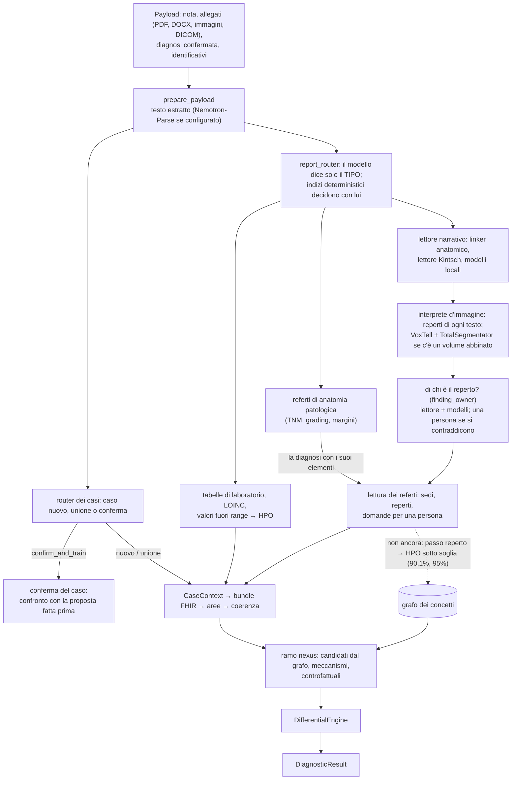

# Architettura e modello dei dati

*[English](../en/ARCHITECTURE.md) · Italiano · verificata sul codice di `main`, 2 novembre 2026*

Melampo trasforma i documenti di un caso clinico in un grafo del caso e in un differenziale ordinato. Ogni passo
che legge un testo lo fanno due lettori che devono essere d'accordo: un lettore deterministico che porta ciò che
sa un radiologo (anatomia, grammatica, ontologie) e i modelli linguistici che leggono la frase. Quando si
contraddicono decide una persona. I testi dei pazienti li leggono solo modelli locali.

## 1. Contesto

```mermaid
flowchart LR
  physician["Medico<br/>(immissione del caso, revisione)"] --> melampo
  hospital[("Documenti dell'ospedale<br/>pseudonimizzati alla fonte")] --> melampo
  subgraph melampo["Melampo (un'installazione, in ospedale)"]
    core["Acquisizione, lettori,<br/>grafo, differenziale"]
    local["Modelli linguistici locali<br/>(Nemotron 3 Ultra, Muse Spark Open;<br/>Gemma 4 come opzione)"]
    graph[("FalkorDB<br/>grafo dei concetti")]
    stores[("Archivi cifrati<br/>casi, conferme")]
  end
  ontologies[("HPO, UBERON, PATO, MONDO,<br/>LOINC, CIPI / ICD-9-CM<br/>(pin con DVC)")] --> melampo
  melampo -->|"probe di ricerca SOLO su corpora PUBBLICI"| openrouter["OpenRouter<br/>(PARROT, IU X-ray, MedMentions)"]
  melampo --> result["Differenziale strutturato<br/>+ domande per una persona"]
```

## 2. Dai documenti al differenziale



Le linee continue girano oggi su `main`; quella tratteggiata no. Due parti sono costruite ma mai eseguite: il
recupero `dual_path` (il router lo calcola, nessuno lo esegue) e l'addestramento (DPO, LoRA: nessuna GPU, nessuna
etichetta confermata).

## 3. Componenti e loro stato

| Componente | Modulo | Stato |
|---|---|---|
| Estrazione dai documenti | `data/document_processing.py` | funziona; senza parser dice `no_text_extracted` |
| Orchestratore dei referti | `data/report_router.py` | funziona: indizi deterministici e modello locale del lettore insieme (acceso quando il server locale è configurato; misura del router: 1,1% e 0,4% dei testi con un interprete mancato, contro il 20,4% dei soli indizi); un modello esterno è rifiutato per i testi dei pazienti |
| Linker anatomico | `memory/anatomy_linker.py`, `memory/chunk_lattice.py` | funziona; si astiene quando non è sicuro |
| Lettore Kintsch | `memory/ci_reader.py`, `memory/spatial_relation.py` | funziona; il secondo stadio legge il ruolo di riferimento |
| Finding owner | `memory/finding_owner.py` | funziona: per affermazioni, accesa di default dal 14 novembre 2026 (`MELAMPO_OWNER_QUESTION=owner` per la domanda v1). Lettori scelti per misura: Nemotron 3 Ultra e Muse Spark Open, entrambi con ragionamento, l'incertezza letta da Muse (ctrate9: 0 errori, 3 dubbi su 293 item); Gemma 4 31B è un'opzione (vedi "Lettori locali" sotto) |
| Ciò che sa il lettore | `memory/what_is_said.py` | anomalie da HPO e PATO, testa del sintagma, negazione, coordinazione |
| Biblioteca di riferimento | `memory/reference_values.py`, `data/reference/` | funziona: valori di riferimento con le fonti; ai modelli vanno solo le righe le cui parole sono state trovate sulla pagina (`verified`), una riga le cui parole non dicono ciò che dice la riga è `doubt`; il lettore ricalcola il confronto della riga citata, e la misura entra nel grafo del caso come valore con la sua riga (`add_measures`), così "milza 15 cm" rende presente la splenomegalia (20 novembre 2026) |
| Diagnosi di anatomia patologica al suo reperto | `data/pathology_findings.py` | funziona: la diagnosi con TNM, grado, margini, linfonodi e marcatori sul suo reperto; le notizie cliniche sono il quesito |
| Indice delle fonti | `memory/sources_index.py`, `data/reference/sources.yml`, `scripts/sources_mask.py` | funziona: letteratura, trattati e documentazione che Melampo legge, come si raggiunge ciascuna e con quale licenza; una maschera su questo computer per aggiungere, modificare e rimuovere le fonti, attivarle per i profili delle malattie e aggiungere PDF; una ricerca settimanale aggiunge documenti candidati; le righe dei riferimenti sono verificate dalle loro parole trovate sulle loro pagine |
| Sezioni del referto | `memory/report_sections.py` | costruito: indicazione, storia, confronto, tecnica, reperti, conclusioni (le sezioni LOINC dei referti); le conclusioni e la frase precedente date come contesto |
| Domanda per una persona | `memory/review_question.py` | funziona; nella lettura del caso come `questions` |
| Interprete d'immagine | `imaging/interpreter.py`, `imaging/segmenters.py` | funziona quando volume e segmentatori sono configurati |
| Reperto → termine HPO | `memory/hpo_candidates.py`, `scripts/hpo_probe.py` | solo prove (90% sicuro, soglia 95%) |
| Grafo dei concetti | `memory/falkordb_graph.py`, `memory/concept_paths.py` | funziona, 636.733 archi verificati |
| Memory retriever | `memory/retriever.py` | **difetto**: inventa prove quando la memoria è vuota |
| Aree funzionali | `areas/*` | contano chiavi di dizionario, non il contenuto: da rifare |
| Ramo nexus, intuizione, differenziale | `training/nexus_*`, `reasoning/*` | funziona |
| Grafo del caso | `clinical/case_graph.py`, `clinical/case_graph_builder.py`, `clinical/manifestation_state.py` | funziona: costruito nell'ingestione di ogni caso; quattro stati di una manifestazione |
| Ramo dei farmaci | `clinical/drug_branch.py`, `scripts/drug_sources.py` | funziona quando la cache locale è configurata (`MELAMPO_DRUG_CACHE`) |
| Profili delle malattie | `memory/disease_profiles.py`, `memory/profile_library.py`, `scripts/disease_profiles.py`, `scripts/disease_names.py` | costruiti: solo fonti certe, nessuna persona conferma; il run con i lettori definitivi è da fare |
| Percorso diagnostico sul grafo | `reasoning/case_diagnosis.py`, `reasoning/likelihood_ranking.py` | funziona quando i profili sono configurati (`MELAMPO_DISEASE_PROFILES`): `case_diagnosis` accanto alla diagnosi; il ciclo è da costruire |
| Conferma e unione dei casi | `training/case_confirmation.py`, `training/patient_matching.py` | funziona |
| Archivio dei casi confermati | `training/confirmed_case_store.py` | cifrato, anonimizzato (HMAC-SHA256) |
| Feedback delle revisioni | `evaluation/review_feedback.py` | un record diventa etichetta solo dopo la conferma di una seconda persona |
| Addestramento | `training/dpo_config.py`, profili LoRA in `evaluation/model_profiles.py` | mai eseguito |
| Maschera di immissione e revisione | — | da costruire (HTML/JS in locale) |

### Lettori locali dei referti

Le affermazioni sono lette da due modelli locali, scelti per misura su campioni etichettati prima di ogni lettura
([VALIDATION](VALIDATION.md), ctrate8 e ctrate9):

| Lettori | ctrate9, 293 item | Hardware (ordine di grandezza) |
|---|---|---|
| **Nemotron 3 Ultra + Muse Spark Open, entrambi con ragionamento** (predefinita) | 0 errori, 3 dubbi (1,0%); incertezza da Muse: 0 perse, 0 date | Nemotron 3 Ultra circa 8 GPU; Muse Spark Open circa 1 TB di memoria |
| Gemma 4 31B + Muse Spark Open con ragionamento (opzione) | 0 errori, 10 dubbi (3,4%) | Gemma 4 31B una GPU da 80 GB; Muse come sopra |
| Gemma 4 31B + Nemotron 3 Ultra con ragionamento | 3 errori, 11 dubbi (3,8%): non scelta | |

Un dubbio resta nel percorso diagnostico con il suo dubbio; solo una discordanza va a una persona. Configurazione:
`MELAMPO_LOCAL_CHAT_ENDPOINT` (solo questa macchina), `MELAMPO_LOCAL_CHAT_MODELS` con i nomi del server e
`+reasoning` (per esempio `nemotron-3-ultra+reasoning,muse-spark-open+reasoning`), `MELAMPO_UNCERTAINTY_FROM`
(predefinito Muse). Un lettore con ragionamento ha 8000 token e il ragionamento è chiesto dal template della chat
(`MELAMPO_LOCAL_CHAT_EXTRA` per un server che lo chiede in altro modo).

**Il root model** del motore ricorsivo è Nemotron 3 Ultra con Gemma 4 31B, senza ragionamento
(`root_model_cross_check.DEFAULT_PAIR`, 14 novembre 2026): su 25 casi valutati, con il motore che mostra al modello
il testo che legge, entrambi hanno risposto giusto a tutti; Muse Spark Open non è passato, né in testo né con gli
strumenti nativi. Il root usa pesi già scelti per i lettori.

**Termini di Muse Spark Open** (come li legge il titolare del progetto il 14 novembre 2026; da confermare nella
revisione legale): la dicitura "Built with Muse Spark Open" è obbligatoria ovunque Melampo sia distribuito o
mostrato con il modello; un modello che ne deriva (un fine-tuning, anche gli adattatori LoRA) è un derivato con gli
stessi termini e la stessa dicitura; la clausola sui minori riguarda chi usa il modello: chi usa Melampo non deve
essere minorenne.

## 4. Modello dei dati e interoperabilità

| Dato | Standard | Dove |
|---|---|---|
| Caso | risorse HL7 FHIR in un bundle (`ClinicalNormalizer`) | `data/normalization.py`, `clinical/schemas.py` |
| Immagini | DICOM; volume + affine in millimetri del paziente | `data/dicom_volume.py` |
| Anatomia | classi di TotalSegmentator ancorate a UBERON (`part_of`, `is_a`) | `data/linking/anatomy_lexicon.json` |
| Fenotipi | HPO con le qualità PATO delle definizioni logiche | `data/hp.obo.dvc` |
| Malattie | MONDO, DOID, annotazioni HPO | `data/*.dvc` |
| Laboratorio | LOINC | `data/` |
| Procedure e diagnosi italiane | CIPI, ICD-9-CM (aggiornamento settimanale) | `data/classifications_it/` |
| Reperto | referto, frase, menzione, struttura, affermazione, qualificatori (certezza, polarità, tempo), misure, lato immagine | `imaging/findings.py` |
| Risultato | `DiagnosticResult`: differenziale, prove a favore e contro, astensione, traccia di audit | `reasoning/diagnostic_result.py` |
| Grafo del caso | rami (farmaci, esami, patologie presenti / ipotizzate / candidate); fatti, conoscenza e inferenza separati; quattro stati di una manifestazione (presente, assente, non valutato, dubbio); scambio in GA4GH Phenopacket v2; memorizzato in FalkorDB | `clinical/case_graph.py`, `clinical/phenopacket.py`, `memory/case_graph_store.py` |

### Il grafo del caso (14 novembre 2026)

L'ingestione costruisce il grafo di ogni caso da ciò che è già letto (`clinical/case_graph_builder.from_ingestion`):
i reperti dei referti con le parole e le posizioni, le righe di laboratorio con la riga stampata e il codice LOINC,
i farmaci e le patologie dichiarati. Il ramo delle candidate è vuoto all'ingresso: solo il percorso diagnostico lo
popola (`CaseGraph.add_candidate`), ogni candidata con ciò che l'ha proposta. `clinical/manifestation_state` dà a
ogni manifestazione di una patologia il suo stato nel paziente: assente se detto, misurato nei limiti, o taciuto da
un esame che ne studia la regione; altrimenti non valutato. `reasoning/likelihood_ranking` pesa le manifestazioni
presenti e assenti come rapporti di verosimiglianza (il metodo di LIRICAL), assenze comprese. Il risultato porta solo
i conteggi (`case_graph`); il grafo resta con il caso.

### Il ramo dei farmaci e i profili delle malattie (15 novembre 2026)

`clinical/drug_branch` risolve ogni farmaco del caso attraverso una cache locale costruita solo da fonti aperte
(`scripts/drug_sources.py`, workflow `drug-sources`): le liste AIFA (nome italiano o AIC -> principio attivo, ATC;
CC BY 4.0), ATC -> nome internazionale (Wikidata CC0, tabella dei medicinali EMA), l'etichetta statunitense (openFDA,
CC0). Trova le frasi di un'etichetta che nominano un altro farmaco del paziente (`DrugInteraction`) o un reperto del
paziente tra gli effetti del farmaco, con il tempo rispetto all'inizio (`DrugEffect`). L'elenco dei farmaci del
paziente non lascia mai la macchina. DDInter (CC BY-NC-SA) e StatPearls (CC BY-NC-ND) sono non commerciali e non si
usano in produzione. `memory/disease_profiles` costruisce il profilo di una malattia da fonti curate (annotazioni HPO, che contengono
quelle di Orphanet, e Disease Ontology) e da pubblicazioni utilizzabili in un prodotto commerciale (CC0, CC BY,
CC BY-SA: NC e ND esclusi): la coppia di lettori elenca le manifestazioni con la loro frase, una frase inventata è
rifiutata, e i giudici decidono ciò che le parole non decidono. Wikipedia è solo un indice: le sue candidate entrano
con una frase di una pubblicazione che cita, mai con il suo testo. Ogni manifestazione porta il livello di evidenza
(stabilita da due fonti indipendenti, riportata da una), e la lettura si misura contro i profili curati di malattie
rare invece che da una persona (workflow `disease-profiles`, con un budget).

**Le fonti dei profili (18 novembre 2026).** Il pilota leggeva al massimo due review per malattia, e 211 delle sue
212 manifestazioni avevano una sola fonte. Ora i profili leggono tutte le fonti che l'indice segna per loro
(`data/reference/sources.yml`, `profiles: true`), ciascuna con il suo connettore
(`memory/literature_connectors.py`): review e linee guida aperte di Europe PMC (quante ne dice `max_documents`),
documenti aggiunti col loro link (PMID, PMCID, DOI, indirizzo), PDF di una cartella; abstract di PubMed, StatPearls e
i PDF personali solo in un'esecuzione di ricerca (`--research`). Una fonte si attiva o disattiva, si aggiunge, si
rimuove o riceve un PDF nella maschera (`scripts/sources_mask.py`); un nuovo tipo di fonte è una classe nel modulo
dei connettori. Un PDF chiuso resta sul computer che lo ha (`data/private/`, mai committata). I lettori sono quelli
dei referti (Nemotron 3 Ultra e Muse Spark Open, con ragionamento; senza tetto dal 20 novembre 2026) e i giudici sono indipendenti da loro (Claude
Sonnet 5, Gemma 4). Il termine HPO si sceglie nella stessa lettura (ogni lettore ne propone uno, deve esistere in
HPO, i giudici lo confermano nella domanda a cui già rispondono) e si aggiunge accanto alle parole della fonte, che
non scompaiono mai; ciò che i lettori chiamano fattore di rischio, sottotipo o meccanismo non è una manifestazione;
lo stesso reperto in altre parole è una sola manifestazione.

### I lettori della letteratura e il percorso diagnostico (20 novembre 2026)

**Lettori.** La letteratura si legge come i referti: Nemotron 3 Ultra e Muse Spark Open, entrambi con il proprio
ragionamento, senza tetto, e spazio sufficiente per finire (60.000 token). Il banco dei lettori
(`scripts/literature_reader_bench.py`, workflow `literature-reader-bench`) ha letto gli stessi 14 testi con tre
configurazioni; le frasi non presenti nel testo sono state 5 per Nemotron + Gemma senza ragionamento, 1 per
Nemotron + Muse con ragionamento pieno, 20 con il ragionamento limitato a 4.000 token (Nemotron riscriveva le frasi
invece di copiarle). I giudici del banco non sono partiti (credito finito): il proprietario ha scelto la
configurazione dei referti. Una citazione che differisce dal testo solo per un apostrofo, un trattino o un punto
elenco è la citazione del testo (correzione dichiarata dopo il run). Lo script dei profili si ferma subito quando
OpenRouter non ha credito e scrive il suo file dopo ogni diagnosi.

**Conoscenza.** I profili sono conoscenza, mai appresa dai pazienti: `memory/profile_library` li carica da
`MELAMPO_DISEASE_PROFILES` (un `profiles.json` del workflow, o una cartella di file), con la versione data
dall'hash del contenuto, che il grafo del caso registra nella sua fotografia. Una patologia si trova per concetto
MONDO o per nome: i nomi in italiano e in inglese vengono da MONDO e Wikidata (`scripts/disease_names.py`, un passo
di `disease-profiles`; `MELAMPO_DISEASE_NAMES`), così "sospetta appendicite acuta" trova "acute appendicitis"; un
nome condiviso da due patologie non ne sceglie nessuna.

**Il percorso diagnostico sul grafo** (`reasoning/case_diagnosis`, eseguito dalla pipeline e restituito come
`case_diagnosis`, accanto alla diagnosi della pipeline, non al suo posto): le patologie presenti e ipotizzate
ricevono il loro profilo; le candidate entrano solo dal percorso, dal differenziale che la pipeline calcola dai
reperti e dai profili che spiegano reperti che nient'altro spiega (almeno due manifestazioni presenti); ogni
manifestazione riceve il suo stato; ipotizzate e candidate sono ordinate insieme per rapporti di verosimiglianza,
con il fondo calcolato su tutta la libreria. Il risultato dà i contributi di ogni patologia, i dubbi, gli esami da
proporre (le manifestazioni non valutate delle prime tre patologie), i reperti ancora non spiegati e la versione
della conoscenza. Ancora da fare: il ciclo fino a quando il differenziale non cambia più, l'esame successivo per
informazione attesa, i farmaci come causa di una candidata, la valutazione sui casi pubblicati. Limite noto: una
manifestazione senza frequenza né tipicità è registrata ma non pesa; i reperti senza concetto HPO si confrontano
solo per parole (il passo reperto → termine HPO non è collegato).

**Pesi misurati (21 novembre 2026).** `scripts/disease_frequencies.py` (workflow `disease-frequencies`) legge, per
ogni patologia di un run dei profili, gli studi di accuratezza diagnostica (sensibilità, specificità, rapporti di
verosimiglianza, con il contesto clinico e i pazienti senza la malattia su cui sono stati misurati) e gli studi
descrittivi (quanti pazienti con la malattia hanno ogni manifestazione); i valori combinati di una meta-analisi si
prendono come sono, gli studi singoli si combinano con un modello a effetti casuali sulla scala logit, i contesti
restano separati; una parola di frequenza ("spesso") si usa solo quando manca un numero, tradotta nelle classi di
frequenza di HPO, e pesa la metà. La classifica usa un rapporto di verosimiglianza misurato prima di qualsiasi
frequenza, con il fondo dato dai pazienti che lo studio ha misurato.

**Una revisione sistematica per ogni patologia (22 novembre 2026).** `scripts/disease_review.py` (workflow
`disease-review`) prende il posto di `disease-profiles` e `disease-frequencies`: per ogni patologia, il metodo di una
revisione sistematica (PRISMA) con i lettori e i giudici di Melampo. I suoi nomi (MONDO, sinonimi; Europe PMC
espande da sé i sinonimi MeSH); lo strato curato (annotazioni HPO con Orphanet, Disease Ontology); tutte le fonti a
strati, ciascuna letta fino in fondo pagina dopo pagina: le fonti dell'indice accese nella maschera, poi su Europe
PMC linee guida, Rational Clinical Examination, revisioni sistematiche della diagnosi, studi di accuratezza
diagnostica, serie descrittive, revisioni, casi clinici; esclusi i titoli su un'altra causa o forma, prognosi,
terapia, fattori di rischio, epidemiologia; ogni abstract selezionato (Gemma 4) prima di leggere il testo; due
lettori, la frase e i suoi numeri nel testo, due giudici che dicono anche che cos'è (manifestazione, esame,
punteggio, esito, fattore di rischio) e a quale manifestazione nota corrisponde; ogni manifestazione curata che
nessun testo ha detto cercata da sola; i pesi nell'ordine di `disease_frequencies`. Esami e punteggi vanno in
`tests.json` e `scores.json`.

**Quando una revisione si ferma: la saturazione è un parametro** (regola del proprietario, 22 novembre 2026).
`--saturation N`: la revisione di una patologia si ferma quando N testi di fila, letti e giudicati, non aggiungono
nessuna manifestazione. Il minimo è 5 (un valore più piccolo è portato a 5); `0` vuol dire nessun limite: si
legge ogni testo di ogni strato, fino a esaurimento delle fonti. Nessun altro limite è fissato prima; solo il
budget ferma un run, e il run successivo riprende da lì (`resume_run`). Per ogni patologia si scrive la curva
dei testi letti e delle manifestazioni aggiunte (`curves.json`).

**La conoscenza versionata e la revisione continua (22 novembre 2026).** Ogni versione della conoscenza delle
patologie è una Release di GitHub, mai un commit: una pre-release con etichetta `knowledge-<data>-<versione>` (che
non si confonde con una versione del software), creata da `scripts/knowledge_release.sh` solo dai due workflow
della conoscenza, e solo quando il contenuto è cambiato (la sua impronta): un push o un merge di codice non ne crea
nessuna. Contiene `knowledge.db` (il grafo, pronto, in FalkorDBLite), i file da cui è costruito (profili, nomi,
esami, punteggi, curve, le misure da cui si calcolano i pesi, il giorno di ogni revisione, i registri di letture e
verdetti; i testi letti non si pubblicano: un abstract o un testo intero appartiene ai suoi autori), `changes.md`
(che cosa è cambiato, patologia per patologia) e `version.json`. Ogni lunedì `disease-review-update` scarica
l'ultima Release, rivede ogni patologia su ciò che è stato pubblicato dal giorno della sua ultima revisione, con lo
stesso metodo, senza saturazione (si legge ogni testo nuovo), ricalcola i pesi su tutte le misure, vecchie e nuove,
e crea una nuova Release se qualcosa è cambiato. Prende il posto dell'aggiornamento giornaliero della letteratura su
`main`, spento lo stesso giorno (si può ancora lanciare a mano).

**Il grafo della conoscenza (22 novembre 2026).** La diagnosi legge la conoscenza come grafo
(`memory/disease_knowledge_graph.py`): `(:KVersion)<-[:IN]-(:KDisease)-[:SHOWS {frequenza, sensibilità,
specificità, LR+, LR-}]->(:KManifestation)` e `(:KDisease)-[:DETECTED_BY]->(:KTest)`, con l'identificativo di versione
che ogni caso registra, così le patologie che mostrano certe manifestazioni sono una sola interrogazione.
`MELAMPO_DISEASE_PROFILES` indica il `knowledge.db` di una Release (aperto con FalkorDBLite, senza ricostruire
nulla), oppure un file o una cartella JSON, oppure `falkordb[:<versione>]` per un server FalkorDB
(`data/falkordb_config.toml`, `MELAMPO_FALKORDB_SERVICE`, `MELAMPO_FALKORDB_USERNAME`, `MELAMPO_FALKORDB_PASSWORD`),
che `scripts/knowledge_graph.py` carica. Lì va solo conoscenza pubblica, mai il caso di un paziente.

## 5. Confini dei dati

| Dati | Possono andare a | Non vanno mai a | Garantito da |
|---|---|---|---|
| Referti e note dei pazienti | modelli locali (`report_router.local_chat`) | qualsiasi servizio esterno | il router rifiuta un endpoint esterno; test `test_an_external_model_is_refused` |
| Corpora pubblici (PARROT, IU X-ray, MedMentions, E3C) | OpenRouter, nelle probe, con `--public-data` | il repository (i testi non si committano: solo le etichette) | `check_endpoint`; test `test_an_external_endpoint_needs_public_texts` |
| Casi confermati | archivio cifrato, anonimizzato con HMAC-SHA256 | l'addestramento senza una base clinica dichiarata | `ConfirmedCaseStore`, `case_confirmation` |
| Risposte delle revisioni | feedback delle revisioni | l'addestramento prima della conferma di una seconda persona | `review_feedback`; test `test_text_that_is_not_pseudonymised_is_refused` |
| Segreti (`DB_PASSWORD`, `OPENROUTER_API_KEY`, `HF_TOKEN`) | ambiente e segreti di GitHub | codice, log, documenti | revisione; mai in un commit |

Nessun componente fa una chiamata di rete che non sia configurata esplicitamente.

## 6. Supervisione umana

Una persona decide ovunque i lettori non siano d'accordo; nulla viene tolto o promosso in silenzio.

- **Lettura di una frase:** né il lettore da solo né i modelli da soli mettono da parte un reperto. Due modelli
  contano come un solo flusso e devono prima essere d'accordo fra loro.
- **Domande per una persona:** complete in sé (frase, struttura, risposte chiuse); le letture del sistema si
  mostrano solo dopo la risposta, così non la orientano.
- **Ipotesi del ramo nexus:** `PromotionPolicy` dà `needs_review`, mai una promozione automatica.
- **Dati di addestramento:** solo casi confermati con una base clinica, e risposte alle revisioni confermate da
  una seconda persona.

## 7. Decisioni

In forma breve; i record completi sono nel tag `docs-archive-2026-11`.

| Data | Decisione | Ancora valida |
|---|---|---|
| 2026-09-26 | Imaging: ogni regione anomala isolata e descritta per dimensione, forma, densità; la discrepanza referto↔immagine è fuori dal perimetro | sì |
| 2026-10-02 | L'archivio dei vettori e dei concetti è FalkorDB, non Weaviate | sì |
| 2026-10-02 | Catena dell'imaging: VoxTell → geometria → abbinamento → nodi del grafo | sì |
| (record RLM) | Il recupero è una navigazione ricorsiva sulla memoria governata, con primitive nominate e senza esecuzione di codice, profondità 1 | sì; `dual_path` non ancora eseguito |
| (record del motore diagnostico) | Il modello ordina le diagnosi; il grafo dice su che cosa poggia ciascuna; un calibratore deterministico decide se un risultato può uscire | sì |
| (record del flusso di ipotesi) | Le ipotesi si trovano nel grafo, non le scrive un modello; isolate dal percorso delle prove | sì |
| 2026-10-12 | Deterministico solo dove il vocabolario ha la corrispondenza esatta; altrimenti leggono il lettore e un modello | sì |
| 2026-10-14 | Opzione b: più ruoli possono essere veri insieme; lettore e modello devono concordare su ciò che cambia l'esito; una persona se si contraddicono | sì |
| 2026-10-30 | Il lettore narrativo e l'interprete d'immagine girano nell'acquisizione | sì |
| 2026-10-31 | Il ruolo di riferimento; il finding owner deciso insieme da lettore e modelli | sì |
| 2026-11-02 | Nessuna etichetta scelta da un elenco ordinato: affermazioni con parole copiate; il lettore controlla con ontologie e grammatica, mai con liste di parole fatte per i casi | sì |
| 2026-11-04 | Una misura si confronta con un valore di riferimento di una fonte citata, mai con ciò che un modello ricorda; paragrafi, non capitoli, delle fonti; per la ricerca letteratura aperta e Radiopaedia | sì |
| 2026-11-07 | Richiamo selettivo: una parola si legge prima nel contesto del referto (la sua struttura, la sua sezione, le sue conclusioni); un senso di un'altra specie non si richiama mai; dove un nome ha un senso del corpo formato e uno dell'embrione, quello dell'embrione si richiama solo in un referto sullo sviluppo (9 novembre 2026). Un reperto può avere più sedi, e più reperti una sede | sì |
| 2026-11-07 | Il principio del dubbio: ciò che non è certo resta nel percorso diagnostico come reperto in dubbio, con ogni lettura accanto, chiuso dalle conclusioni, dalla conoscenza non ambigua del lettore (HPO, PATO), da altri referti, dall'anamnesi o da un esame nuovo; certo quando lo sostengono due fonti di meccanismo diverso; alla persona solo una discordanza del documento; ogni quota di errore sotto il 2% | sì |
| 2026-11-08 | La diagnosi del patologo è data al suo reperto con TNM, grado, margini, linfonodi e marcatori; le notizie cliniche di un istologico sono il quesito, il materiale è da dove viene il campione; un elemento si dà solo dove appartiene con certezza (la sua riga della diagnosi, o l'unica struttura che la diagnosi nomina), altrimenti resta con il referto e dice perché | sì |
| 2026-11-08 | Un valore di riferimento vale perché lo dice la sua fonte: una riga è verificata quando le parole che cita si trovano sulla sua pagina, parola per parola; nessuno stato si fonda sulla memoria di una persona, nemmeno di un radiologo; le fonti sono indicizzate con il modo di raggiungerle, aggiornate ogni settimana dalla ricerca del progetto e a mano con una maschera | sì |
| 2026-11-09 | Le strutture dell'embrione non si escludono in anticipo: un nome con un solo senso lo tiene («trofoblasto»); un nome con un senso del corpo formato e uno dell'embrione («arco aortico») richiama quello dell'embrione solo in un referto ostetrico, fetale o di gravidanza | sì |
