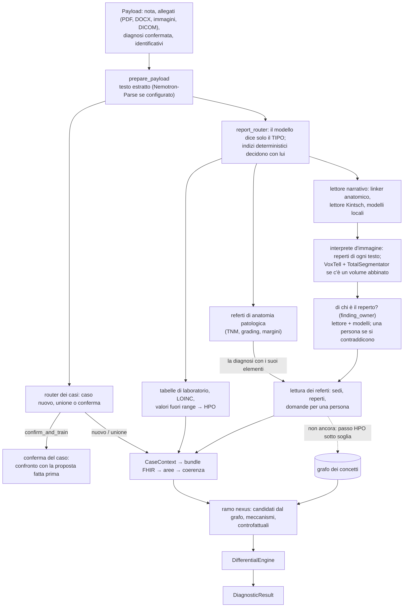

# Architettura e modello dei dati

*[English](../en/ARCHITECTURE.md) · Italiano · verificata sul codice di `main`, 2 novembre 2026*

Melampo trasforma i documenti di un caso clinico in un grafo del caso e in un differenziale ordinato. Ogni passo
che legge un testo lo fanno due lettori che devono essere d'accordo: un lettore deterministico che porta ciò che
sa un radiologo (anatomia, grammatica, ontologie) e i modelli linguistici che leggono la frase. Quando si
contraddicono decide una persona. I testi dei pazienti li leggono solo modelli locali.

## 1. Contesto

```mermaid
flowchart LR
  physician["Medico<br/>(immissione del caso, revisione)"] --> melampo
  hospital[("Documenti dell'ospedale<br/>pseudonimizzati alla fonte")] --> melampo
  subgraph melampo["Melampo (un'installazione, in ospedale)"]
    core["Acquisizione, lettori,<br/>grafo, differenziale"]
    local["Modelli linguistici locali<br/>(Gemma 4, Nemotron 3 Ultra)"]
    graph[("FalkorDB<br/>grafo dei concetti")]
    stores[("Archivi cifrati<br/>casi, conferme")]
  end
  ontologies[("HPO, UBERON, PATO, MONDO,<br/>LOINC, CIPI / ICD-9-CM<br/>(pin con DVC)")] --> melampo
  melampo -->|"probe di ricerca SOLO su corpora PUBBLICI"| openrouter["OpenRouter<br/>(PARROT, IU X-ray, MedMentions)"]
  melampo --> result["Differenziale strutturato<br/>+ domande per una persona"]
```

## 2. Dai documenti al differenziale



Le linee continue girano oggi su `main`; quella tratteggiata no. Due parti sono costruite ma mai eseguite: il
recupero `dual_path` (il router lo calcola, nessuno lo esegue) e l'addestramento (DPO, LoRA: nessuna GPU, nessuna
etichetta confermata).

## 3. Componenti e loro stato

| Componente | Modulo | Stato |
|---|---|---|
| Estrazione dai documenti | `data/document_processing.py` | funziona; senza parser dice `no_text_extracted` |
| Orchestratore dei referti | `data/report_router.py` | funziona; un modello esterno è rifiutato per i testi dei pazienti |
| Linker anatomico | `memory/anatomy_linker.py`, `memory/chunk_lattice.py` | funziona; si astiene quando non è sicuro |
| Lettore Kintsch | `memory/ci_reader.py`, `memory/spatial_relation.py` | funziona; il secondo stadio legge il ruolo di riferimento |
| Finding owner | `memory/finding_owner.py` | funziona con la domanda v1; lettura per affermazioni costruita, spenta (`MELAMPO_OWNER_QUESTION=claims`) |
| Ciò che sa il lettore | `memory/what_is_said.py` | anomalie da HPO e PATO, testa del sintagma, negazione, coordinazione |
| Biblioteca di riferimento | `memory/reference_values.py`, `data/reference/` | costruita: valori di riferimento con le fonti (da verificare), paragrafi in una copia locale; i modelli confrontano una misura solo con una riga citata, il lettore ricalcola il confronto |
| Sezioni del referto | `memory/report_sections.py` | costruito: indicazione, storia, confronto, tecnica, reperti, conclusioni (le sezioni LOINC dei referti); le conclusioni e la frase precedente date come contesto |
| Domanda per una persona | `memory/review_question.py` | funziona; nella lettura del caso come `questions` |
| Interprete d'immagine | `imaging/interpreter.py`, `imaging/segmenters.py` | funziona quando volume e segmentatori sono configurati |
| Reperto → termine HPO | `memory/hpo_candidates.py`, `scripts/hpo_probe.py` | solo prove (90% sicuro, soglia 95%) |
| Grafo dei concetti | `memory/falkordb_graph.py`, `memory/concept_paths.py` | funziona, 636.733 archi verificati |
| Memory retriever | `memory/retriever.py` | **difetto**: inventa prove quando la memoria è vuota |
| Aree funzionali | `areas/*` | contano chiavi di dizionario, non il contenuto: da rifare |
| Ramo nexus, intuizione, differenziale | `training/nexus_*`, `reasoning/*` | funziona |
| Conferma e unione dei casi | `training/case_confirmation.py`, `training/patient_matching.py` | funziona |
| Archivio dei casi confermati | `training/confirmed_case_store.py` | cifrato, anonimizzato (HMAC-SHA256) |
| Feedback delle revisioni | `evaluation/review_feedback.py` | un record diventa etichetta solo dopo la conferma di una seconda persona |
| Addestramento | `training/dpo_config.py`, profili LoRA in `evaluation/model_profiles.py` | mai eseguito |
| Maschera di immissione e revisione | — | da costruire (HTML/JS in locale) |

## 4. Modello dei dati e interoperabilità

| Dato | Standard | Dove |
|---|---|---|
| Caso | risorse HL7 FHIR in un bundle (`ClinicalNormalizer`) | `data/normalization.py`, `clinical/schemas.py` |
| Immagini | DICOM; volume + affine in millimetri del paziente | `data/dicom_volume.py` |
| Anatomia | classi di TotalSegmentator ancorate a UBERON (`part_of`, `is_a`) | `data/linking/anatomy_lexicon.json` |
| Fenotipi | HPO con le qualità PATO delle definizioni logiche | `data/hp.obo.dvc` |
| Malattie | MONDO, DOID, annotazioni HPO | `data/*.dvc` |
| Laboratorio | LOINC | `data/` |
| Procedure e diagnosi italiane | CIPI, ICD-9-CM (aggiornamento settimanale) | `data/classifications_it/` |
| Reperto | referto, frase, menzione, struttura, affermazione, qualificatori (certezza, polarità, tempo), misure, lato immagine | `imaging/findings.py` |
| Risultato | `DiagnosticResult`: differenziale, prove a favore e contro, astensione, traccia di audit | `reasoning/diagnostic_result.py` |

## 5. Confini dei dati

| Dati | Possono andare a | Non vanno mai a | Garantito da |
|---|---|---|---|
| Referti e note dei pazienti | modelli locali (`report_router.local_chat`) | qualsiasi servizio esterno | il router rifiuta un endpoint esterno; test `test_an_external_model_is_refused` |
| Corpora pubblici (PARROT, IU X-ray, MedMentions, E3C) | OpenRouter, nelle probe, con `--public-data` | il repository (i testi non si committano: solo le etichette) | `check_endpoint`; test `test_an_external_endpoint_needs_public_texts` |
| Casi confermati | archivio cifrato, anonimizzato con HMAC-SHA256 | l'addestramento senza una base clinica dichiarata | `ConfirmedCaseStore`, `case_confirmation` |
| Risposte delle revisioni | feedback delle revisioni | l'addestramento prima della conferma di una seconda persona | `review_feedback`; test `test_text_that_is_not_pseudonymised_is_refused` |
| Segreti (`DB_PASSWORD`, `OPENROUTER_API_KEY`, `HF_TOKEN`) | ambiente e segreti di GitHub | codice, log, documenti | revisione; mai in un commit |

Nessun componente fa una chiamata di rete che non sia configurata esplicitamente.

## 6. Supervisione umana

Una persona decide ovunque i lettori non siano d'accordo; nulla viene tolto o promosso in silenzio.

- **Lettura di una frase:** né il lettore da solo né i modelli da soli mettono da parte un reperto. Due modelli
  contano come un solo flusso e devono prima essere d'accordo fra loro.
- **Domande per una persona:** complete in sé (frase, struttura, risposte chiuse); le letture del sistema si
  mostrano solo dopo la risposta, così non la orientano.
- **Ipotesi del ramo nexus:** `PromotionPolicy` dà `needs_review`, mai una promozione automatica.
- **Dati di addestramento:** solo casi confermati con una base clinica, e risposte alle revisioni confermate da
  una seconda persona.

## 7. Decisioni

In forma breve; i record completi sono nel tag `docs-archive-2026-11`.

| Data | Decisione | Ancora valida |
|---|---|---|
| 2026-09-26 | Imaging: ogni regione anomala isolata e descritta per dimensione, forma, densità; la discrepanza referto↔immagine è fuori dal perimetro | sì |
| 2026-10-02 | L'archivio dei vettori e dei concetti è FalkorDB, non Weaviate | sì |
| 2026-10-02 | Catena dell'imaging: VoxTell → geometria → abbinamento → nodi del grafo | sì |
| (record RLM) | Il recupero è una navigazione ricorsiva sulla memoria governata, con primitive nominate e senza esecuzione di codice, profondità 1 | sì; `dual_path` non ancora eseguito |
| (record del motore diagnostico) | Il modello ordina le diagnosi; il grafo dice su che cosa poggia ciascuna; un calibratore deterministico decide se un risultato può uscire | sì |
| (record del flusso di ipotesi) | Le ipotesi si trovano nel grafo, non le scrive un modello; isolate dal percorso delle prove | sì |
| 2026-10-12 | Deterministico solo dove il vocabolario ha la corrispondenza esatta; altrimenti leggono il lettore e un modello | sì |
| 2026-10-14 | Opzione b: più ruoli possono essere veri insieme; lettore e modello devono concordare su ciò che cambia l'esito; una persona se si contraddicono | sì |
| 2026-10-30 | Il lettore narrativo e l'interprete d'immagine girano nell'acquisizione | sì |
| 2026-10-31 | Il ruolo di riferimento; il finding owner deciso insieme da lettore e modelli | sì |
| 2026-11-02 | Nessuna etichetta scelta da un elenco ordinato: affermazioni con parole copiate; il lettore controlla con ontologie e grammatica, mai con liste di parole fatte per i casi | sì |
| 2026-11-04 | Una misura si confronta con un valore di riferimento di una fonte citata, mai con ciò che un modello ricorda; paragrafi, non capitoli, delle fonti; per la ricerca letteratura aperta e Radiopaedia | sì |
| 2026-11-07 | Richiamo selettivo: una parola si legge prima nel contesto del referto (la sua struttura, la sua sezione, le sue conclusioni); un senso estraneo (un'altra specie, l'embrione) non si richiama se il referto non lo dice. Un reperto può avere più sedi, e più reperti una sede | sì |
| 2026-11-07 | Il principio del dubbio: ciò che non è certo resta nel percorso diagnostico come reperto in dubbio, con ogni lettura accanto, chiuso dalle conclusioni, dalla conoscenza non ambigua del lettore (HPO, PATO), da altri referti, dall'anamnesi o da un esame nuovo; certo quando lo sostengono due fonti di meccanismo diverso; alla persona solo una discordanza del documento; ogni quota di errore sotto il 2% | sì |
| 2026-11-08 | La diagnosi del patologo è data al suo reperto con TNM, grado, margini, linfonodi e marcatori; le notizie cliniche di un istologico sono il quesito, il materiale è da dove viene il campione; un elemento si dà solo dove appartiene con certezza (la sua riga della diagnosi, o l'unica struttura che la diagnosi nomina), altrimenti resta con il referto e dice perché | sì |
